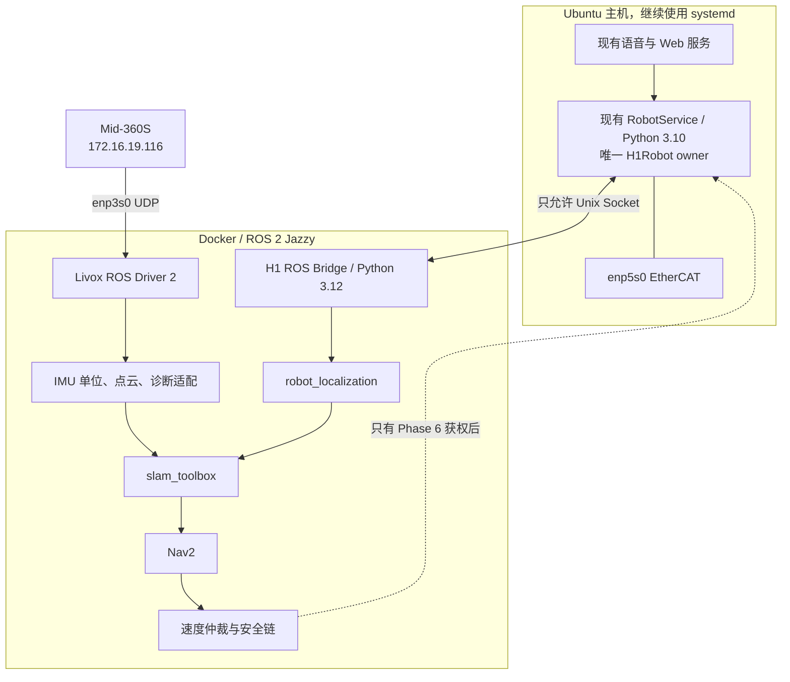

# ZERITH H1 PRO：Docker、ROS 2、Livox 与导航部署细化方案

> 日期：2026-08-31<br>
> 性质：实施设计和命令模板，**本轮没有执行安装、构建、启动或控制机器人**。<br>
> 总体方案见：[IMU_LIDAR_NAVIGATION_PLAN.md](IMU_LIDAR_NAVIGATION_PLAN.md)。

## 1. 不变的网络基线

下列配置已经在实机完成并验证，后续 Docker 和 ROS 配置只能使用它们，不能改回旧网段：

```text
Wi-Fi / wlp4s0:       172.16.18.43/24
Wi-Fi 默认网关:       172.16.18.1

雷达口 / enp3s0:      172.16.19.43/24
兼容 secondary:       172.31.200.1/24（暂时保留）
雷达 / Mid-360S:      172.16.19.116/24
雷达网关:             172.16.19.43

状态目标:              172.16.19.43:56201
点云目标:              172.16.19.43:56301
雷达 IMU 目标:         172.16.19.43:56401
```

硬限制：

- `enp5s0` 是 EtherCAT，禁止桥接进 Docker、修改 IP、停口或交给 Livox 驱动；
- Livox Viewer 2、SDK2 quick-start、ROS Driver 2 同一时刻只能有一个 master；
- Docker 启停不能调用 `nmcli`，不能修改雷达 IP，也不能改变主机默认路由；
- 初期 ROS 只在本机发现，不能把 DDS 直接暴露到 Wi-Fi/LAN。

## 2. 当前机器是否还需要安装 Docker

不需要。只读检查确认：

```text
Ubuntu:          24.04.3 LTS / noble / x86_64
Docker Engine:   29.7.2
Docker Compose:  5.5.0
docker.service:  enabled + active
robot 用户:      已属于 docker 组
Docker socket:   root:docker 0660
GPU:             RTX 4090 Laptop / 16 GB
```

正式开始实施时只需再次验证：

```bash
docker version
docker compose version
docker info
systemctl is-active docker
id
```

`docker` 组等价于给该用户很高的主机权限，不能让 Web API 或未经认证的网络请求任意拼接并执行 Docker 命令。

### 2.1 仅供重装系统后的 Docker 安装模板

本机现在**不要重复执行**。如果以后在一台全新的 Ubuntu 24.04 主机重建，使用 Docker 官方 APT 源，不使用旧的 `docker.io` 与 Compose standalone：

```bash
sudo apt-get update
sudo apt-get install -y ca-certificates curl
sudo install -m 0755 -d /etc/apt/keyrings
sudo curl -fsSL https://download.docker.com/linux/ubuntu/gpg \
  -o /etc/apt/keyrings/docker.asc
sudo chmod a+r /etc/apt/keyrings/docker.asc

echo "Types: deb
URIs: https://download.docker.com/linux/ubuntu
Suites: noble
Components: stable
Architectures: amd64
Signed-By: /etc/apt/keyrings/docker.asc" \
  | sudo tee /etc/apt/sources.list.d/docker.sources >/dev/null

sudo apt-get update
sudo apt-get install -y \
  docker-ce docker-ce-cli containerd.io \
  docker-buildx-plugin docker-compose-plugin
sudo systemctl enable --now docker.service containerd.service
sudo usermod -aG docker robot
```

重新登录后验证：

```bash
docker run --rm hello-world
docker compose version
```

不要把 sudo 密码写进 Dockerfile、Compose、环境变量或 Git 仓库。

## 3. 推荐的部署边界

不建议“整套控制全部 Docker 化”。最稳妥的是混合部署：



原因：

- H1 SDK 是 CPython 3.10，ROS 2 Jazzy 默认 Python 3.12，不能直接混装；
- 现有 `RobotService` 已经是 H1 SDK 的唯一 owner，不能再创建第二个 `H1Robot`；
- EtherCAT 和实体控制留在主机，容器不获得 `/dev`、`--privileged` 或 `enp5s0` 权限；
- ROS/Livox/Nav2 依赖放进镜像，便于固定版本、回滚和复制；
- 二维导航不需要 GPU，不安装 NVIDIA Container Toolkit，也不和中文 TTS 抢显存。

## 4. 建议的目录规划

以下是未来实施时应创建的目标结构，本轮没有创建：

```text
/home/robot/control/navigation/
├── compose.yaml
├── docker/
│   ├── Dockerfile.ros2
│   └── ros_entrypoint.sh
├── config/
│   ├── mid360s_172_16_19_116.json
│   ├── h1_ekf.yaml
│   ├── slam_toolbox.yaml
│   ├── nav2.yaml
│   ├── collision_monitor.yaml
│   └── safety_limits.yaml
├── src/
│   ├── zerith_bringup/
│   ├── h1_ros_bridge/
│   └── lidar_processing/
├── urdf/
│   └── h1_navigation.urdf.xacro
├── maps/
├── data/
│   ├── bags/
│   ├── diagnostics/
│   └── livox_logs/
└── systemd/
    └── zerith-ros-sensors.service
```

原则：

- `config/`、`urdf/` 只读挂载进容器；
- `maps/` 和 `data/` 用主机 bind mount，不能只存在容器可写层；
- bag、地图和诊断文件归 `robot:robot` 所有；
- 镜像标签记录 Git commit，验收后再记录镜像 digest；
- 不把模型、bag、构建目录和雷达日志提交 Git。

## 5. ROS 2 / Livox 镜像方案

### 5.1 固定版本

```text
基础镜像:           ros:jazzy-ros-base-noble
ROS 2:              Jazzy
Livox SDK2 commit:   08f523c930b2f0ba1e98a6afaa8d7476bf479908
ROS Driver 2 tag:    1.2.6
ROS Driver commit:   13eb05e4e6dd7a765b934d0c5fd6236676a57b49
设备配置键:          Mid360s（大小写敏感）
```

构建验收后，把基础镜像从浮动 tag 改成 `tag@sha256:digest`。不要长期跟随 `master`，也不要在生产机器人上每次启动时 `apt upgrade` 或重新拉源码。

### 5.2 Dockerfile 目标模板

下面是实施模板，不是已经生成的文件：

```dockerfile
FROM ros:jazzy-ros-base-noble

SHELL ["/bin/bash", "-o", "pipefail", "-c"]
ARG DEBIAN_FRONTEND=noninteractive
ARG LIVOX_SDK2_COMMIT=08f523c930b2f0ba1e98a6afaa8d7476bf479908
ARG LIVOX_ROS2_COMMIT=13eb05e4e6dd7a765b934d0c5fd6236676a57b49

RUN apt-get update && apt-get install -y --no-install-recommends \
    build-essential cmake git libapr1-dev libpcl-dev \
    python3-colcon-common-extensions python3-rosdep \
    ros-jazzy-ament-cmake-auto \
    ros-jazzy-pcl-conversions \
    ros-jazzy-rclcpp-components \
    ros-jazzy-rosidl-default-generators \
    ros-jazzy-rosbag2 \
    ros-jazzy-robot-localization \
    ros-jazzy-pointcloud-to-laserscan \
    ros-jazzy-pcl-ros \
    ros-jazzy-slam-toolbox \
    ros-jazzy-navigation2 \
    ros-jazzy-nav2-bringup \
    ros-jazzy-xacro \
    ros-jazzy-diagnostic-updater \
    ros-jazzy-tf2-tools \
 && rm -rf /var/lib/apt/lists/*

RUN git clone https://github.com/Livox-SDK/Livox-SDK2.git /opt/Livox-SDK2 \
 && git -C /opt/Livox-SDK2 checkout "${LIVOX_SDK2_COMMIT}" \
 && cmake -S /opt/Livox-SDK2 -B /opt/Livox-SDK2/build \
      -DCMAKE_BUILD_TYPE=Release \
 && cmake --build /opt/Livox-SDK2/build --parallel \
 && cmake --install /opt/Livox-SDK2/build \
 && ldconfig

RUN mkdir -p /opt/zerith_ws/src \
 && git clone https://github.com/Livox-SDK/livox_ros_driver2.git \
      /opt/zerith_ws/src/livox_ros_driver2 \
 && git -C /opt/zerith_ws/src/livox_ros_driver2 checkout "${LIVOX_ROS2_COMMIT}" \
 && cp /opt/zerith_ws/src/livox_ros_driver2/package_ROS2.xml \
       /opt/zerith_ws/src/livox_ros_driver2/package.xml \
 && cp -r /opt/zerith_ws/src/livox_ros_driver2/launch_ROS2 \
       /opt/zerith_ws/src/livox_ros_driver2/launch

WORKDIR /opt/zerith_ws
RUN source /opt/ros/jazzy/setup.bash \
 && colcon build --merge-install \
      --cmake-args -DROS_EDITION=ROS2 -DDISTRO_ROS=jazzy \
                   -DCMAKE_BUILD_TYPE=Release

RUN useradd --uid 1000 --user-group --create-home robot
USER robot
WORKDIR /home/robot
```

实施时还应：

1. 先单独构建 Livox 层，确认 SDK 库位于 `/usr/local/lib`；
2. 再构建 ROS 驱动层，确认 `ros2 pkg prefix livox_ros_driver2`；
3. 记录 `docker image inspect` 输出、镜像 digest、APT 包版本和源码 commit；
4. 后续再改为多阶段构建，减小运行镜像；
5. 不在镜像中复制 sudo 密码、SSH key、GitHub token 或 H1 控制密钥。

## 6. Docker 网络怎么配置

### 6.1 必须使用 host network

Livox 通过 UDP 发现和固定目标端口发包，雷达当前明确把数据发给主机地址 `172.16.19.43`。因此传感器容器使用：

```yaml
network_mode: host
```

不要使用默认 bridge、macvlan，也不要写 `ports:`：

- bridge 会让容器拥有另一个私网 IP，增加广播发现、回包和 UDP 映射复杂度；
- macvlan 会制造另一个二层身份，并可能诱使人再次改雷达回传目标；
- host 模式让容器共享 Linux 主机网络栈，雷达仍然只认识已经固定的 `.19.43`；
- host 模式下 `ports:` 会被忽略；
- 不需要 `--privileged`，这些 Livox 端口都高于 1024。

容器的 Livox JSON 仍然写主机真实地址 `172.16.19.43`，不是容器名、`127.0.0.1` 或 Docker 网桥地址。

### 6.2 ROS DDS 初期只允许本机

初期建议所有 ROS 容器统一：

```yaml
environment:
  ROS_DOMAIN_ID: "43"
  ROS_LOCALHOST_ONLY: "1"
  RMW_IMPLEMENTATION: "rmw_fastrtps_cpp"
```

这样多个 host-network 容器可以在同一台主机通信，但不会把 ROS topic 直接广播到 `172.16.18.0/24`。需要远程看图时，优先单独部署带认证和防火墙限制的可视化桥，而不是把整个 DDS 域开放到 Wi-Fi。

若后续因 Fast DDS 共享内存或多容器发现出现问题，再以一次性试验比较 `ipc: host` 或 CycloneDDS；不要同时改 RMW、QoS、网络模式和驱动版本，否则无法定位问题。

## 7. Mid-360S 配置

目标配置文件内容：

```json
{
  "lidar_summary_info": {
    "lidar_type": 8
  },
  "Mid360s": {
    "lidar_net_info": {
      "cmd_data_port": 56100,
      "push_msg_port": 56200,
      "point_data_port": 56300,
      "imu_data_port": 56400,
      "log_data_port": 56500
    },
    "host_net_info": [
      {
        "host_ip": "172.16.19.43",
        "cmd_data_port": 56101,
        "push_msg_port": 56201,
        "point_data_port": 56301,
        "imu_data_port": 56401,
        "log_data_port": 56501
      }
    ]
  },
  "lidar_configs": [
    {
      "ip": "172.16.19.116",
      "pcl_data_type": 1,
      "pattern_mode": 0,
      "extrinsic_parameter": {
        "roll": 0.0,
        "pitch": 0.0,
        "yaw": 0.0,
        "x": 0,
        "y": 0,
        "z": 0
      }
    }
  ]
}
```

说明：

- `Mid360s` 来自实机协议类型 35 和官方 1.2.6 模板；
- `pcl_data_type=1` 表示 32 位笛卡尔坐标；
- `pattern_mode=0` 保持当前非重复扫描；
- JSON 外参暂时为零只是表示“不在驱动内烘焙外参”；
- 真正的 `base_link -> livox_frame` 必须标定并由 TF 发布；
- 启动时检查雷达网络配置没有被驱动改写。

一期驱动参数：

```text
xfer_format:      0        # PointCloud2，保留 Livox 扩展字段和逐点 timestamp
multi_topic:      0        # 当前只有一个雷达
data_src:         0        # 实时雷达
publish_freq:     10.0 Hz
output_data_type: 0
frame_id:         livox_frame
```

官方 `msg_MID360s_launch.py` 默认 `xfer_format=1`，本项目一期必须显式覆盖为 `0`，不能只依赖上游默认值。

## 8. Compose 目标模板

第一阶段只定义传感器和工具容器。下面仍是方案模板：

```yaml
name: zerith-navigation

x-ros-common: &ros-common
  image: zerith/ros2-nav:jazzy-livox-1.2.6
  build:
    context: .
    dockerfile: docker/Dockerfile.ros2
  network_mode: host
  environment:
    ROS_DOMAIN_ID: "43"
    ROS_LOCALHOST_ONLY: "1"
    RMW_IMPLEMENTATION: "rmw_fastrtps_cpp"
  user: "1000:1000"
  security_opt:
    - no-new-privileges:true
  cap_drop:
    - ALL
  volumes:
    - ./config:/opt/zerith/config:ro
    - ./urdf:/opt/zerith/urdf:ro
    - ./maps:/opt/zerith/maps
    - ./data:/opt/zerith/data
    - /etc/localtime:/etc/localtime:ro
  tmpfs:
    - /tmp
  stop_grace_period: 5s
  logging:
    driver: local
    options:
      max-size: "20m"
      max-file: "5"

services:
  lidar_driver:
    <<: *ros-common
    restart: "no"
    command:
      - bash
      - -lc
      - >-
        source /opt/ros/jazzy/setup.bash &&
        source /opt/zerith_ws/install/setup.bash &&
        ros2 run livox_ros_driver2 livox_ros_driver2_node --ros-args
        -p xfer_format:=0
        -p multi_topic:=0
        -p data_src:=0
        -p publish_freq:=10.0
        -p output_data_type:=0
        -p frame_id:=livox_frame
        -p user_config_path:=/opt/zerith/config/mid360s_172_16_19_116.json

  ros_tools:
    <<: *ros-common
    profiles: ["tools"]
    restart: "no"
    command: ["bash", "-lc", "source /opt/ros/jazzy/setup.bash && sleep infinity"]
```

实现 `lidar_processing`、H1 bridge、SLAM 和 Nav2 后，再增加独立服务。不要一开始把所有节点塞进一个容器，也不要给任何服务 `privileged: true`。

初期 `restart: "no"` 是有意的：驱动崩溃后先保留现场。完成重连和数据新鲜度诊断验收后，传感器服务可以改为 `on-failure:3`；导航控制服务仍不应无限自动重启并自动获权。

## 9. Docker 日常怎么用

以下命令只在未来方案获准实施、文件实际生成后使用。

### 9.1 构建和检查

```bash
cd /home/robot/control/navigation
docker compose config
docker compose build --pull
docker image ls 'zerith/ros2-nav*'
```

含义：

- `config`：只校验 Compose 展开结果；
- `build --pull`：构建镜像并更新指定基础镜像；验收后生产构建应改用固定 digest；
- 构建失败时保留完整日志，不通过删除缓存来掩盖依赖问题。

### 9.2 启动雷达，只读验证

先关闭 Viewer，避免抢占：

```bash
systemctl --user stop livox-viewer2.service
cd /home/robot/control/navigation
docker compose --profile tools up -d lidar_driver ros_tools
docker compose ps
docker compose logs --tail=100 lidar_driver
```

若 Viewer 不是 systemd 启动，应确认 Viewer 窗口和进程均已退出。

### 9.3 在容器中检查 ROS topic

```bash
cd /home/robot/control/navigation
docker compose exec ros_tools bash -lc '
  source /opt/ros/jazzy/setup.bash
  source /opt/zerith_ws/install/setup.bash
  ros2 topic list -t
'
```

继续检查：

```bash
docker compose exec ros_tools bash -lc '
  source /opt/ros/jazzy/setup.bash
  source /opt/zerith_ws/install/setup.bash
  ros2 topic info -v /livox/lidar
'

docker compose exec ros_tools bash -lc '
  source /opt/ros/jazzy/setup.bash
  source /opt/zerith_ws/install/setup.bash
  ros2 topic hz /livox/lidar
'

docker compose exec ros_tools bash -lc '
  source /opt/ros/jazzy/setup.bash
  source /opt/zerith_ws/install/setup.bash
  ros2 topic hz /livox/imu
'
```

`topic hz` 需要按 `Ctrl+C` 结束。不要 `echo` 整个点云，它会制造大量终端输出和额外负载。

### 9.4 录制静态 rosbag

```bash
docker compose exec ros_tools bash -lc '
  source /opt/ros/jazzy/setup.bash
  source /opt/zerith_ws/install/setup.bash
  ros2 bag record -o /opt/zerith/data/bags/livox_static_01 \
    /livox/lidar /livox/imu
'
```

第一包先录 60 秒；确认磁盘增量、消息频率、时间戳和可回放后，再做 10 分钟 soak test。bag 必须落到主机的 `data/bags/`，而不是容器层。

### 9.5 停止和恢复 Viewer

```bash
cd /home/robot/control/navigation
docker compose down --timeout 10
/home/robot/Viewer2_2.5.9_Linux/LivoxViewer2.sh
```

`docker compose down` 不会改变主机固定 IP，也不会改雷达网段。不要随意执行 `docker compose down -v`、`docker system prune -a` 或删除 `data/`；这些操作可能删除持久数据或其他项目镜像。

## 10. 雷达 IMU 如何使用

Mid-360S 内置 IMU 用于点云去畸变/LIO，不应冒充 H1 机身 IMU。

官方协议定义：

```text
角速度: rad/s
加速度: g
```

而 ROS `sensor_msgs/Imu.linear_acceleration` 要求 `m/s²`。因此必须增加适配节点：

```text
/livox/imu              原始驱动数据，不直接融合
  -> g × 9.80665
  -> frame/covariance/时间有效性检查
  -> /livox/imu_si
```

适配规则：

- 三轴 acceleration 全部乘 `9.80665`；
- angular velocity 保持 rad/s；
- orientation 不可用时将 `orientation_covariance[0] = -1`；
- frame 必须是经过验证的 `livox_imu_link` 或明确的 `livox_frame`；
- 非有限值、时间倒退、数据超龄直接标诊断错误；
- 不把 `/livox/imu` 和 `/livox/imu_si` 同时送进同一融合器。

## 11. H1 机身 IMU 与轮速如何跨进 Docker

H1 SDK 继续由主机上的现有 Python 3.10 `RobotService` 独占。未来在同一个 worker 增加只读快通道：

```text
50 Hz 目标：getIMU_State() + getChassisSpeedState()
2–5 Hz：     电机、电池、模式等慢状态
```

主机通过版本化 Unix Socket 输出，建议：

```text
主机路径:    /run/user/1000/zerith-h1/telemetry.sock
容器内路径:  /run/zerith-h1/telemetry.sock
权限:        robot:robot 0660
```

Compose 只读遥测 bridge 的挂载：

```yaml
volumes:
  - /run/user/1000/zerith-h1:/run/zerith-h1
```

容器只发布：

```text
/h1/body_imu/raw
/h1/wheel_twist
/h1/wheel_odom_raw
/diagnostics
```

禁止事项：

- 不把 `/dev/imu` 挂进容器；
- 不把 H1 SDK `.so` 强行加载到 ROS 2 Python 3.12；
- 不在容器创建第二个 `H1Robot`；
- Phase 2 只读 socket 不能接受轮速命令；
- 控制 socket 必须在 Phase 6 单独设计，并有身份、lease、限幅和 watchdog。

## 12. TF、外参和里程计配置

### 12.1 TF 树

```text
map
└── odom
    └── base_footprint
        └── base_link
            ├── body_imu_link
            └── livox_frame
                └── livox_imu_link
```

所有固定外参放在 URDF/TF，不写进 Livox JSON。实施文件先用显式占位符阻止误启动：

```xml
<origin xyz="MEASURE_X MEASURE_Y MEASURE_Z"
        rpy="MEASURE_ROLL MEASURE_PITCH MEASURE_YAW"/>
```

未标定前，RViz Fixed Frame 可以临时用 `livox_frame` 看原始点云；不能发布假的 identity `base_link -> livox_frame` 来让导航“看起来能跑”。

### 12.2 一期 EKF 输入

来源未查明前采用保守组合：

```text
线速度 vx: H1 speed_algo.v
角速度 wz: H1 body IMU gyro z
世界位姿: 不由 H1 SDK 提供
```

`robot_localization` 目标配置骨架：

```yaml
ekf_filter_node:
  ros__parameters:
    frequency: 30.0
    sensor_timeout: 0.10
    two_d_mode: true
    publish_tf: true
    map_frame: map
    odom_frame: odom
    base_link_frame: base_footprint
    world_frame: odom

    odom0: /h1/wheel_odom_raw
    odom0_config: [false, false, false,
                   false, false, false,
                   true,  false, false,
                   false, false, false,
                   false, false, false]

    imu0: /h1/body_imu/raw
    imu0_config: [false, false, false,
                  false, false, false,
                  false, false, false,
                  false, false, true,
                  false, false, false]
```

数组顺序为 `x,y,z,roll,pitch,yaw,vx,vy,vz,vroll,vpitch,vyaw,ax,ay,az`。协方差必须用静态和低速标定数据估计；不要全部填零。

如果确认 `speed_algo.angular` 已融合同一 H1 IMU，就不能再以高权重重复融合 body gyro。该问题必须通过厂商确认和延迟/相关性实测后决定。

## 13. 从三维点云生成二维导航输入

目标处理链：

```text
/livox/lidar
 -> 有限值、tag、距离过滤
 -> 机器人自身点过滤
 -> 按已标定 TF 转到 base_link
 -> 地面/顶面/高度窗口过滤
 -> 动态时逐点去畸变
 -> /scan
 -> /lidar/points_obstacles
```

`pointcloud_to_laserscan` 的目标配置骨架：

```yaml
pointcloud_to_laserscan:
  ros__parameters:
    target_frame: base_link
    transform_tolerance: 0.05
    min_height: MEASURE_FROM_ROBOT_GEOMETRY
    max_height: MEASURE_FROM_ROBOT_GEOMETRY
    angle_min: -3.14159
    angle_max: 3.14159
    angle_increment: 0.00873
    scan_time: 0.10
    range_min: MEASURE_AND_VALIDATE
    range_max: 20.0
    use_inf: true
```

`min_height/max_height/range_min` 不能照抄占位值。先测雷达高度、底盘轮廓、手臂导航姿态和盲区，再决定。Mid-360S 非重复扫描若单帧太稀疏，只允许在有时间补偿的前提下累计 2–3 帧。

## 14. 建图配置与使用顺序

### 14.1 `slam_toolbox` 骨架

```yaml
slam_toolbox:
  ros__parameters:
    mode: mapping
    map_frame: map
    odom_frame: odom
    base_frame: base_footprint
    scan_topic: /scan
    resolution: 0.05
    minimum_time_interval: 0.10
    transform_publish_period: 0.05
    transform_timeout: 0.20
    max_laser_range: 20.0
```

这些只是首轮参数。正确顺序是：

1. 静止录包，验证点云、IMU、TF 和时间；
2. 只读 H1 遥测，验证 wheel odom 连续；
3. 人工遥控低速走直线和原地转向，检查双墙和拉花；
4. 固定双臂、腰、头为导航姿态；
5. 人工绕场建图并完成回环；
6. 保存 pose graph 与 occupancy map；
7. 重启后在已知区域验证重定位。

建图阶段 Nav2 不向底盘输出速度。

## 15. Nav2 如何分阶段配置

### 15.1 planning 模式：生成路径但不接轮子

输入：

```text
map -> odom -> base_footprint TF
/scan
/lidar/points_obstacles
/odometry/filtered
地图与 footprint
```

推荐起点：

```text
全局规划器: SmacPlanner2D 或 NavFn
控制器:     Regulated Pure Pursuit
全局地图:   StaticLayer + InflationLayer + keepout
局部地图:   rolling VoxelLayer/ObstacleLayer + InflationLayer
```

planning 模式将 Nav2 输出接到记录/检查节点，不允许连到 H1 gateway。验证速度、加速度、TF、footprint、障碍层、断流行为和 goal cancel。

### 15.2 live 模式：最后才接闭环

唯一合法的命令链：

```text
Nav2 / 人工 / Web / 语音目标
 -> source mux + authority/lease
 -> velocity smoother
 -> collision monitor
 -> gateway 硬限幅
 -> 350 ms watchdog
 -> 差速换算
 -> 现有唯一 RobotService
 -> 左右轮
```

初始限制：

```yaml
max_v: 0.15
max_omega: 0.30
max_accel_x: 0.20
max_decel_x: -0.30
max_accel_w: 0.40
max_decel_w: -0.60
command_rate_hz: 20
gateway_watchdog_s: 0.35
```

这些值只是首次封闭场地测试上限。实车从 `0.05 m/s` 开始。语音“去接待台”应转换为导航目标，不应绕过安全链发固定时间轮速。

## 16. 容器分档与允许权限

| 档位 | 运行内容 | 是否能下发轮速 | 启动方式 |
|---|---|---:|---|
| sensors | Livox、IMU 单位适配、诊断、rosbag | 否 | 完成 Phase 1 后可考虑开机启动 |
| telemetry | H1 只读 UDS bridge、EKF | 否 | 完成 Phase 2 后可随 sensors 启动 |
| mapping | 点云处理、slam_toolbox | 否，由人工现有控制建图 | 人工启动 |
| planning | Nav2 规划、costmap、命令审计 sink | 否 | 人工启动 |
| live | mux、smoother、collision monitor、控制 bridge | 是 | 双人现场、实体急停、显式 arm |

建议 Compose 使用 profiles 表达这四档。`live` profile 不设置 `restart: always`，不随开机自动启动，必须经过显式 operator arm 才申请控制 authority。

## 17. 以后是否设置开机启动

Phase 1 连续通过后，只允许把 `sensors` 做成 system service：

```ini
[Unit]
Description=ZERITH ROS 2 sensor containers
Requires=docker.service
After=docker.service network-online.target
Wants=network-online.target

[Service]
Type=oneshot
RemainAfterExit=yes
User=robot
Group=robot
WorkingDirectory=/home/robot/control/navigation
ExecStart=/usr/bin/docker compose up -d lidar_driver
ExecStop=/usr/bin/docker compose down --timeout 10
TimeoutStartSec=120

[Install]
WantedBy=multi-user.target
```

启用前必须满足：

- Viewer 没有开机自启；
- 驱动重启不改写固定 IP；
- 10 分钟 soak test 通过；
- 断流诊断能区分“进程活着”和“数据新鲜”；
- 容器停止后端口释放；
- 四个现有语音/控制服务回归正常。

`mapping`、`planning`、`live` 都不进入这个开机 unit。

## 18. 验收清单

### 18.1 Docker 和网络

- 容器使用 host network，无 `ports:`、无 macvlan、无 privileged；
- `ip route get 172.16.19.116` 仍为 `dev enp3s0 src 172.16.19.43`；
- 默认路由仍只有 `172.16.18.1 dev wlp4s0`；
- `enp5s0` 未被 Compose 引用；
- 停止容器后可正常启动 Viewer；
- 所有容器日志有轮转，bag 落在主机目录。

### 18.2 传感器

- 雷达 SN 为 `ARMCP6S0039816`，设备类型为 Mid-360S；
- `/livox/lidar` 接近目标 10 Hz；
- `/livox/imu` 频率、单位、时间、frame 有记录；
- `/livox/imu_si` 静止加速度模长约 `9.80665 m/s²`；
- 10 分钟无持续丢包、非有限值、时间倒退、无界内存增长；
- driver kill/restart 后恢复，雷达 IP 和回传目标不变。

### 18.3 定位和安全

- TF 无双发布者、无回环、无伪造零外参；
- wheel odom、H1 gyro 和雷达定位符号一致；
- 地图无明显双墙、拖影和回环撕裂；
- planning profile 绝不触达轮速 setter；
- live profile 中任何数据超龄、轮错误码、权限超时或定位失效都输出零速；
- Web、语音、Nav2 同时请求时只有一个来源获权；
- 实体急停独立于 Docker、ROS 和软件 watchdog。

## 19. 推荐的实际实施顺序

```text
第 1 步：只生成 Dockerfile、Compose、Mid360s JSON，不启动
第 2 步：构建固定版本镜像，做镜像内单元检查
第 3 步：关闭 Viewer，启动 lidar_driver，录 60 秒静态 bag
第 4 步：完成 10 分钟雷达 soak test 和重启恢复测试
第 5 步：实现雷达 IMU g -> m/s² 适配与诊断
第 6 步：在主机唯一 RobotService 接出只读 H1 IMU/轮速 UDS
第 7 步：容器 bridge + EKF，只验证 odom，不控制底盘
第 8 步：标定 TF、轮速比例、符号和时间
第 9 步：点云过滤、LaserScan、人工低速建图
第 10 步：Nav2 planning profile，不接轮子
第 11 步：安全链故障注入和 rosbag 回放测试
第 12 步：封闭场地、双人、实体急停、0.05 m/s live 测试
```

当前下一步应该是第 1 步，但只有在用户明确授权“开始工程”后才创建上述目录和配置；目前保持网络和现有服务不变。

## 20. 参考

- [Docker Engine Ubuntu 官方安装](https://docs.docker.com/engine/install/ubuntu/)
- [Docker host network 官方说明](https://docs.docker.com/engine/network/drivers/host/)
- [Docker Linux 安装后配置](https://docs.docker.com/engine/install/linux-postinstall/)
- [ROS 官方 Docker 镜像](https://hub.docker.com/_/ros)
- [Livox SDK2 固定 commit](https://github.com/Livox-SDK/Livox-SDK2/tree/08f523c930b2f0ba1e98a6afaa8d7476bf479908)
- [Livox ROS Driver 2 1.2.6](https://github.com/Livox-SDK/livox_ros_driver2/releases/tag/1.2.6)
- [官方 Mid360S 1.2.6 配置](https://github.com/Livox-SDK/livox_ros_driver2/blob/13eb05e4e6dd7a765b934d0c5fd6236676a57b49/config/MID360s_config.json)
- [Nav2 Jazzy 安装](https://docs.nav2.org/jazzy/getting_started/build_and_install/)
- [Nav2 + SLAM](https://docs.nav2.org/jazzy/tutorials/general_tutorials/navigation2_with_slam/navigation2_with_slam/)
