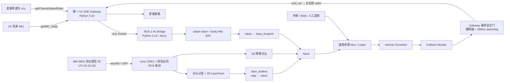

# ZERITH H1 PRO 机身 IMU、Mid-360 雷达接入与自主导航实施方案

> 文档日期：2026-08-31
> 分析对象：`/home/robot/control`、H1 SDK 1.3.9、目标机器人实机
> 参考资料：`ZERITH H1 PRO产品使用手册 V2.0.pdf`、`ZERITH H1 PRO系列SDK开发指南 V4.0.pdf`
> 初始分析范围：只读调查、被动抓包、架构与实施方案；没有改变机器人模式或发送运动指令。
> 实施更新（2026-08-31 17:54 CST）：已完成雷达与主机固定网段迁移；全过程未修改 `enp5s0` 或发送机器人运动指令。

## 1. 先给结论

这台 H1 PRO 已经具备完成室内自主导航所需的三类基础信息，但它们来自三条不同链路，不能混为一个“机器人 SDK”：

1. **H1 机身 IMU 已经可以读取。** 公开 SDK 提供 `getIMU_State()`，包含姿态、角速度、加速度、四元数和错误码；没有公开的 IMU 启停、复位或标定控制接口。IMU 是观测传感器，不是像关节一样的执行器。
2. **底盘既能控制，也能读取速度反馈。** 当前项目使用 LOW_LEVEL，向左右轮分别发送 rad/s；SDK 还能返回左右轮实际转速以及底盘算法解算的线速度 `v` 和角速度 `ω`。但 SDK **不提供 x/y/yaw 世界位姿，也没有可用的轮位置反馈**，所以必须自行构造轮式里程计，再由雷达定位校正漂移。
3. **底盘雷达是独立的 Livox 以太网设备。** 产品信息字符串为 Mid-360，但发现协议的设备类型字段为 `0x23`（35，即 SDK2 的 `Mid360s`）；H1 SDK 中没有 `getLidar()` 或 `getPointCloud()`。点云和雷达内置 IMU 必须通过 Livox SDK2 / 经实机兼容性确认的 ROS 驱动接出。
4. **固定网段迁移已经完成。** 雷达为 `172.16.19.116/24`，主机雷达口为 `172.16.19.43/24`；状态、点云和 IMU 分别回传至 `56201/56301/56401`。SDK2 已实际收到点云与 IMU，雷达状态中 `lidar_diag_status=0`、全部 HMS code 为 0。
5. **推荐一期导航主线：** ROS 2 Jazzy + Livox ROS Driver 2 + 点云过滤/二维投影 + `slam_toolbox` + Nav2；本地短时里程计由 H1 轮速 `v/ω` 与 H1 机身 IMU 融合。二期再评估 3D LIO，不建议把尚无官方 ROS 2 主线的 FAST-LIO2 直接作为一期唯一定位源。
6. **导航最终控制的对象是底盘，不是 IMU 或 LiDAR。** Nav2 连续输出 `(v, ω)`，经过限速、平滑、碰撞监控、控制仲裁和看门狗后，才转换成左右轮速度；绝不能继续用“1.5 rad/s 持续若干秒”的语音脉冲当作导航。

推荐的一期闭环如下：



## 2. 已确认事实、当前缺口与禁止推断

### 2.1 厂商资料确认的硬件和接口

| 项目 | 已确认事实 | 证据 |
|---|---|---|
| 底盘 | 差速底盘，两只主动轮；额定整机移动速度 0.7 m/s | 产品手册 V2.0，第 12 页 |
| 传感器 | 1 台激光雷达、1 个六轴 IMU | 产品手册 V2.0，第 13 页 |
| 雷达 | 底盘中心 Livox Mid-360；厂商交付说明称 `172.31.200.X/24` | SDK 指南 V4.0，第 55–56 页 |
| 低层底盘控制 | 左/右轮 ID 0/1，`Motor_Control.Speed`，单位 rad/s | SDK 指南 V4.0，第 28 页 |
| 高层底盘控制 | `setChassis_high(v, ω)`，m/s、rad/s，仅 HIGH_LEVEL | SDK 指南 V4.0，第 33 页 |
| 底盘反馈 | 左右轮 rad/s、算法线速度 m/s、角速度 rad/s | SDK 指南 V4.0，第 40–41 页 |
| 机身 IMU | `getIMU_State()`；PDF 明列 RPY、角速度和错误码 | SDK 指南 V4.0，第 48 页 |

本机安装的 SDK 1.3.9 头文件与 Python 类型桩比 PDF 更完整，还明确提供：

```text
rpy[3]   = [roll, pitch, yaw]       rad
omega[3] = [wx, wy, wz]             rad/s
accel[3] = [ax, ay, az]             m/s²
quat[4]  = [w, x, y, z]
error_flag = 0 正常，非 0 异常
```

代码证据：

- `H1_SDK_1.3.9/robot_SDK/include/H1_Robot.hpp:235`
- `H1_SDK_1.3.9/robot_SDK/include/ZCM_Data/ImuData.hpp:14`
- `H1_SDK_1.3.9/h1_sdk_v1.3.9_python3.10/lib/lib_h1_sdk_python.pyi:177`

### 2.2 实机只读调查结果

| 项目 | 当前实机状态 | 结论 |
|---|---|---|
| 操作系统 | Ubuntu 24.04.3 LTS，x86_64 | 应选 ROS 2 Jazzy |
| GPU | RTX 4090 Laptop，16 GB 显存 | 足以做点云处理和后续 LIO，但一期不依赖 GPU |
| ROS / Livox 软件 | 未安装 `/opt/ros`、SDK2、ROS Driver 2、Nav2 | 需要新建独立 ROS 工作区 |
| H1 SDK Python | CPython 3.10 | 与 Jazzy 默认 Python 3.12 存在 ABI 边界 |
| 机身 IMU 设备 | `/dev/imu -> /dev/ttyACM0`，Yesense USB CDC ACM | 已由 H1 SDK 使用，不应再并发直开串口 |
| `enp3s0` | UP，`172.16.19.43/24` + `172.31.200.1/24`，1 Gbit/s Full Duplex | 雷达专用网段已打通；第二地址暂时兼容 `.231` 设备 |
| `enp5s0` | EtherCAT EtherType `0x88a4`，SDKService 正在高频使用 | **绝不能改 IP、停口、桥接或给 Livox 驱动使用** |
| 雷达端口监听 | Livox Viewer 2 已绑定 `172.16.19.43:56000/56301/56401` | Viewer 已按新主机地址启动 |
| 当前路由 | 只有 `default via 172.16.18.1 dev wlp4s0` | 雷达口已设 `never-default`，旧的自指网关已清除 |

### 2.3 已确认的雷达身份和网络

在 `enp3s0` 上只做被动抓包，设备每秒广播状态推送。报文中直接包含以下字段：

```text
discovery_dev_type:0x23 / 35 / Mid360s
product_info:      DevType:Mid-360
serial_number:     ARMCP6S0039816
source_mac:        ec:72:f7:0c:d1:aa
lidar_ip:          172.16.19.116
netmask:           255.255.255.0
configured_gateway:172.16.19.43
firmware:          App FmVer 35010108
firmware_build:    2025/06/09
status_target:      172.16.19.43:56201
point_target:       172.16.19.43:56301
imu_target:         172.16.19.43:56401
imu_data_en:        1
esc_mode:           0
lidar_diag_status:  0
```

迁移前雷达为 `192.168.1.116/24`，并持续 ARP 查询旧目标
`192.168.1.5`；这曾是收不到点云的直接原因。现在 SDK2 已确认新网络参数，
并实际接收到 1380-byte 点云 UDP 包和 60-byte IMU UDP 包。

`dnsmasq` 分配的 `172.31.200.231` 属于另一 MAC，不能作为雷达地址；旧文档中的 `.232` 也不能继续使用。

### 2.4 目前绝对不能直接假定的内容

以下信息在两份 PDF 和公开 SDK 中都没有完整定义，必须实测或向 ZERITH 获取：

- H1 机身 IMU 的安装位置和精确 `base_link -> body_imu_link` 外参；
- H1 IMU 的 x/y/z 方向、四元数是 body-to-world 还是 world-to-body；
- yaw 的零点、欧拉角旋转顺序、重启后是否保持；
- H1 IMU 与底盘反馈的硬件采样时间、延迟和协方差；
- 主动轮有效半径 `r`、有效轮距 `B`、轮速符号和减速比；
- `base_link -> livox_frame` 的真实六自由度外参；
- Mid-360 当前 `time_type` 是无同步、PTP/gPTP 还是 GPS。

**不能把机器人外壳宽度当轮距，不能把“雷达在底盘中心”当作零外参，也不能把 H1 yaw 当磁北。**

## 3. “把 IMU 接出来”应该怎么做

### 3.1 读取接口

Python 调用形式为：

```python
ok, imu = robot.getIMU_State()
if ok and int(imu.error_flag) == 0:
    rpy = list(imu.rpy)
    omega = list(imu.omega)
    accel = list(imu.accel)
    quat_wxyz = list(imu.quat)
```

项目中已经有可复用的正确序列化代码：

- `read_robot_state.py:146-157`：读取并输出 RPY、角速度、加速度、WXYZ 四元数和错误码；
- `read_robot_state.py:173-186`：读取左右轮速度和 `speed_algo=[v,ω]`。

当前网页服务 `web_control/robot_service.py` 已在唯一 SDK worker 中读取底盘和电池，但 `_poll_state()` 尚未读取 IMU。不要为了 IMU 再启动第二个 `H1Robot`：厂商类是单例语义，当前项目也明确要求唯一 owner，第二客户端可能争用 ZCM/设备状态。

### 3.2 推荐的 fast telemetry 改造

当前全身状态轮询默认 5 Hz，并且每次遍历 23 个电机，不适合导航。推荐在**同一个 SDK worker** 内拆为两档：

- 快通道，目标 50 Hz，实际频率先测量：只读 `getIMU_State()` 和 `getChassisSpeedState()`；
- 慢通道，2–5 Hz：23 电机、电池、模式、初始化状态；
- 控制命令优先于遥测，任何读取不能长期阻塞 SDK worker；
- 每次读取同时记录 `host_monotonic_ns`、开始/结束时刻、getter 延迟、有效性和连续失败数；
- 读取失败时发布 `valid=false`，绝不能把旧值改个新时间戳继续发布。

建议的内部数据协议：

```yaml
schema_version: 1
sample_seq: 123
host_monotonic_ns: 0
host_wall_ns: 0
read_latency_us: 0
body_imu:
  valid: true
  rpy_rad: [0.0, 0.0, 0.0]
  omega_rad_s: [0.0, 0.0, 0.0]
  accel_m_s2: [0.0, 0.0, 9.81]
  quaternion_wxyz: [1.0, 0.0, 0.0, 0.0]
  error_flag: 0
chassis:
  valid: true
  wheel_actual_rad_s: [0.0, 0.0]
  measured_twist: {linear_m_s: 0.0, angular_rad_s: 0.0}
```

原生消息没有传感器时间戳，因此第一版只能明确标记：

```text
timestamp_source = host_receive
integration_clock = host_monotonic
ros_stamp_source  = paired_host_wall_time
```

单调时钟只用于 `dt`、数据年龄和 watchdog，**不能把 `CLOCK_MONOTONIC` 数值直接写进 ROS `header.stamp`**。每次 getter 返回时应尽可能紧邻地成对采集 `time.monotonic_ns()` 与 `time.time_ns()`；前者用于计算，后者转换成同次样本的 ROS System Time。持续监控两者偏移，系统时间发生跳变时将数据标 invalid、停止导航并重新建立映射。不要把 host receive 写成“硬件同步时间”。

### 3.3 ROS `sensor_msgs/Imu` 转换注意事项

H1 SDK 四元数是 `[w,x,y,z]`，ROS 字段是 `x,y,z,w`，至少需要重排：

```text
ros.orientation.x = h1.quat[1]
ros.orientation.y = h1.quat[2]
ros.orientation.z = h1.quat[3]
ros.orientation.w = h1.quat[0]
```

但是重排不等于坐标已正确。必须先验证轴向和四元数变换方向，再决定是否做固定旋转或共轭。

建议初期发布两个话题：

```text
/h1/body_imu/raw       sensor_msgs/msg/Imu
/h1/body_imu/status    diagnostic_msgs/msg/DiagnosticArray
```

初期融合策略应保守：

- 可先使用经过符号验证的 `angular_velocity.z`；
- roll/pitch 可用于倾斜和安全诊断；
- 六轴 IMU 没有磁力计，不应未经重启/漂移测试融合绝对 yaw；
- 线加速度是否包含重力，先在整机正常姿态做静态模长/轴向测试；只有传感器可安全拆下并由厂商允许时才做六面标定，不能翻倒整机；
- 协方差必须由静态数据和重复试验估计，不能全部填 0；若 orientation 尚未验证，按 `sensor_msgs/Imu` 约定将 `orientation_covariance[0] = -1` 表示该估计不可用，不要发布一个看似高精度的假姿态。

### 3.4 上车前 IMU 验证

1. 静止记录 10 分钟：实际更新率、重复样本、getter 延迟、gyro bias、噪声、温漂、四元数范数。
2. 正常竖直静止：验证加速度模长是否约 `9.80665 m/s²`，以及重力在哪个轴。
3. 低速左转/右转：验证 `omega_z`、RPY yaw、四元数解算 yaw 和底盘 `speed_algo.angular` 的符号一致。
4. 断电重启：检查 yaw 是否归零或跳变，决定它能否作为相对方向观测。
5. 不要为了验证 x/y 轴去倾倒这台约 111 kg 的机器人；使用安全坡板或厂商安装定义。

## 4. “把底盘信息接出来并控制”应该怎么做

### 4.1 状态接口不是位姿接口

```python
ok, wheel_actual, speed_algo = robot.getChassisSpeedState()
# wheel_actual = [left_rad_s, right_rad_s]
# speed_algo   = [linear_m_s, angular_rad_s]
```

SDK 指南第 40 页明确说明：底盘是速度模式，`getChassisState()` 中只有 `Speed_Actual` 和 `Error_flag` 有效。**不能使用 `Position_Actual` 做轮编码器位移。**

第一版轮式里程计应直接积分厂商已经解算的 `v/ω`，不依赖未知轮径：

```text
theta_mid = theta + 0.5 * omega * dt
x         = x + v * cos(theta_mid) * dt
y         = y + v * sin(theta_mid) * dt
theta     = wrap(theta + omega * dt)
```

`dt` 先用相邻 host monotonic 接收时刻计算。该结果是短时连续的 `wheel_odom`，不是全球真值；轮胎滑移、万向轮摆动、碰撞和原地转向都会累积误差，最终必须由雷达 SLAM/定位产生 `map -> odom` 修正。

`speed_algo` 名字表明它是厂商算法输出，但文档没有说明其中 `ω` 是纯轮速解算、是否已经使用同一个 H1 IMU、滤波延迟是多少。因此在来源确认前，不能把 `speed_algo.angular` 与 H1 `omega_z` 当成两条完全独立观测并同时高权重融合。保守做法是：先把完整 `speed_algo` 当单一 odom 基线；或者只取其 `v`，用 H1 gyro z 提供转动；完成轮径/轮距标定后，再从左右轮实际转速独立解算 wheel twist。

### 4.2 两种控制模式

| 方案 | SDK 接口 | 优点 | 代价 | 适用场景 |
|---|---|---|---|---|
| LOW_LEVEL | `setChassis_low(0/1, wheel_rad_s)` | 与当前逐关节、挥手、握手代码共存；可复用现有安全门禁 | 必须标定轮径/轮距并做 `(v,ω)->(wl,wr)` | **推荐，保留整机动作能力** |
| HIGH_LEVEL | `setChassis_high(v,ω)` | Nav2 `cmd_vel` 可直接映射 | 与当前 LOW_LEVEL 初始化互斥；切模式需要 deinit/reinit 且会引起机器人动作 | 纯导航专用运行模式 |

当前项目在 LOW_LEVEL 下工作，并已有：

- 单一 SDK owner；
- 3 秒控制 lease；
- 350 ms 底盘命令 watchdog；
- 双轮 setter 任一失败时尝试双轮归零；
- 归零失败后台重试；
- 轮电机错误码、电池、充电态、初始化和模式门禁。

导航必须复用这条链路，不能新增一个绕过这些保护的 ROS 底盘驱动。

### 4.3 LOW_LEVEL 的差速换算与标定

理论关系为：

```text
wl = (v - B*omega/2) / r
wr = (v + B*omega/2) / r
```

其中 `r` 是有效轮半径，`B` 是有效轮距。实机轮子安装方向可能导致符号不同，所以最终应使用实测的仿射/增益模型，而不是只抄公式：

```text
[wl, wr] = calibrated_inverse_kinematics(v_cmd, omega_cmd)
```

标定最少包含：

1. 五组低速直行，测量实际距离与 `∫v dt`，拟合线速度比例和零偏；
2. 五组低速原地旋转，使用地面角度标记或外部定位，拟合角速度比例和有效轮距；
3. 正反向、左/右转分别测量，检查死区、非对称和回差；
4. 不同地面材质重复，估计滑移协方差；
5. 用 `getChassisSpeedState().speed_algo` 做反馈监控，但不要把同源轮速的多个派生量重复当独立观测融合。

### 4.4 导航命令必须是连续闭环

推荐命令链。所有可能产生轮速的来源必须在安全链之前汇合，不能让 Web 或语音旁路 Collision Monitor：

```text
/cmd_vel_nav + /cmd_vel_teleop + /cmd_vel_web
  -> source_mux / lease arbiter
  -> nav2_velocity_smoother（20 Hz）
  -> collision_monitor
  -> h1_base_bridge 最终安全门
  -> RobotService 350 ms watchdog
```

Velocity Smoother 的 `CLOSED_LOOP` 依赖高频、低延迟 odom。先用 `OPEN_LOOP` 验证命令限幅；当 `/odometry/filtered` 稳定达到 30–50 Hz 且数据年龄通过验收后，再切 `CLOSED_LOOP`。

这里的 `source_mux` 不是现有 3 秒 lease 自动具备的能力。当前 `RobotService` lease 覆盖整台机器人，Web/语音还能直接调用底盘 API；实施导航时必须重构为一个唯一的运动权限管理器：

1. 权限管理器是唯一可以持有/调用 RobotService 底盘能力的入口；
2. Nav2、Web、手柄和语音只提交速度意图或导航目标，不能直达 `/api/motion/chassis`；
3. 导航授权期间，现有直达底盘端点必须拒绝非权限管理器调用；
4. 人工接管顺序固定为：取消 Nav2 goal -> mux 输出零速 -> SDK 接受零速 -> 轮速反馈降至停止阈值 -> 转移 authority/lease；
5. 逐关节动作与自主底盘导航默认互斥，除非另行完成动态 footprint 和整机碰撞验收。

第一轮实机参数建议从以下保守值开始，而不是直接使用 SDK 极限：

```yaml
max_v:       0.15        # m/s
max_omega:   0.30        # rad/s
max_accel_x: 0.20        # m/s²
max_decel_x: -0.30       # m/s²
max_accel_w: 0.40        # rad/s²
max_decel_w: -0.60       # rad/s²
command_rate: 20         # Hz
base_watchdog: 0.35      # s，沿用现有硬门
```

这些是**初始工程上限，不是最终标定值**。产品手册给出的 0.7 m/s 是整机能力，不代表 111 kg 机器人可以在未验收导航时以该速度运行。

实体急停不属于软件仲裁，它必须是独立硬件链路，任何软件状态都不能屏蔽。软件 authority 优先级建议固定为：

```text
软件安全停 > 本地人工遥控 > Web 接管 > Nav2 > 语音动作
```

只有**当前获权来源**超时才由 mux 显式输出零速；未获权来源的心跳或超时只更新自身状态，不能用零速干扰合法控制。切换来源前必须按上述反馈闭环确认停车。

语音在“导航模式”下应发送 `NavigateToPose` 或预设站点目标，例如“去接待台”，而不是直接发固定时间轮速。保留的“前进一点、左转”人工动作也必须经过同一个 mux、限速、Collision Monitor 和 gateway watchdog。

## 5. “把 Mid-360 接出来”应该怎么做

### 5.1 网络恢复的最低风险方案

本节保留已经完成的迁移过程，供故障恢复和审计使用，**不要再次照做**。
迁移前，厂商 PDF 说交付网段是 `172.31.200.X`，但实机报文证明雷达当时
是 `192.168.1.116`，且期望主机 `192.168.1.5`。

迁移时第一步没有写雷达，只在 `enp3s0` 上增加了一个 secondary 地址：

```bash
# 先确认其他接口没有 192.168.1.0/24 路由，并探测 .5 是否冲突
ip route show
sudo arping -D -I enp3s0 -c 3 192.168.1.5

# 临时验证，重启后消失；执行前再次确认接口名
sudo ip address add 192.168.1.5/24 dev enp3s0
```

只有 `arping -D` 未发现地址冲突时才增加地址。如果 `.5` 已被占用，应停止并重新设计雷达目标主机地址，不能强占。

保留 `172.31.200.1/24` 可以避免尚未确认的 `.231` 设备失去服务。验证完成后，再通过 NetworkManager 持久化两个地址，并满足：

```text
enp3s0 addresses: 172.31.200.1/24, 192.168.1.5/24
gateway:          none
DNS:              none
never-default:    true
```

不要照抄连接名执行，应先查：

```bash
nmcli -t -f NAME,UUID,DEVICE,TYPE connection show --active
nmcli -f NAME,UUID,DEVICE,IP4.ADDRESS,IP4.GATEWAY connection show
```

### 5.1.1 验证完成后的固定网段

若希望把雷达网络长期固定，并让地址外观接近本机 Wi-Fi 的
`172.16.18.43/24`，推荐使用一个**相邻但不重叠**的专用网段：

```text
Wi-Fi / wlp4s0:       172.16.18.43/24    默认路由仍走这里
雷达口 / enp3s0:      172.16.19.43/24    无网关、无 DNS、never-default
Mid-360:              172.16.19.116/24
Mid-360 gateway:      172.16.19.43
状态回传目标:          172.16.19.43:56201
点云回传目标:          172.16.19.43:56301
IMU 回传目标:          172.16.19.43:56401
```

不要把 `enp3s0` 和 `wlp4s0` 都放进 `172.16.18.0/24`，也不要在两块网卡上
重复使用 `172.16.18.43`。同一前缀挂在两块独立二层接口上会产生并列的
on-link 路由、ARP 选口歧义和回包走错接口；Wi-Fi station 也不适合用普通
Linux bridge 来补救。

迁移必须按以下顺序完成：

1. 在 `enp3s0` 上临时同时增加 `192.168.1.5/24` 和
   `172.16.19.43/24`，先确认目标地址无冲突；
2. 使用官方 Livox Viewer 2，或 Livox SDK2 的 `SetLivoxLidarIp`、
   `SetLivoxLidarStateInfoHostIPCfg`、`SetLivoxLidarPointDataHostIPCfg`、
   `SetLivoxLidarImuDataHostIPCfg`，只操作 SN `ARMCP6S0039816`；
3. 将雷达 IP、掩码、网关和三类回传目标写成上表数值；雷达 IP 参数需要
   重启才生效，必须等写入成功 ACK 后再重启；
4. 从 `172.16.19.43` 验证新雷达地址、状态、点云和 IMU；验证失败时重新
   加回 `192.168.1.5/24`，按原值 `192.168.1.116/24` 恢复；
5. 最后持久化 NetworkManager 配置并删除临时 `192.168.1.5/24`。

当前 `enp3s0` 网络上还有 MAC `9c:69:d3:91:7c:22` 通过 dnsmasq 获取
`172.31.200.231`。其用途尚未确认，所以第一阶段保留
`172.31.200.1/24` 作为第二地址，不停止 dnsmasq：

```bash
# 执行前先核对连接仍然绑定 enp3s0
nmcli -t -f NAME,UUID,DEVICE connection show --active

sudo nmcli connection modify '有线连接 1' \
  ipv4.method manual \
  ipv4.addresses '172.16.19.43/24,172.31.200.1/24' \
  ipv4.gateway '' \
  ipv4.never-default yes \
  ipv4.ignore-auto-dns yes \
  connection.autoconnect yes

sudo nmcli connection up '有线连接 1'
```

这会同时清除当前错误的 `default via 172.31.200.1 dev enp3s0`；该网关实际
指向主机自己，不应存在。固定后应满足：

```bash
ip route get 172.16.19.116
# 期望：dev enp3s0 src 172.16.19.43

ip route show default
# 期望：只有 default via 172.16.18.1 dev wlp4s0
```

待确认 `.231` 设备不再需要 DHCP 后，才能另行删除
`172.31.200.1/24` 和 `/etc/dnsmasq.d/lidar-net.conf`；这不是本次雷达迁移的
必要步骤。

**`enp5s0` 是 EtherCAT 总线，任何上述命令都不得用于 `enp5s0`。**

### 5.2 驱动配置

目标机 Ubuntu 24.04 对应 ROS 2 Jazzy。当前官方 `livox_ros_driver2` 1.2.6 已声明支持 Ubuntu 24.04/Jazzy，建议固定发布 tag 和源码哈希，不跟随 master 漂移。

官方 README 同时把 ROS Driver 2 定位为测试/调试参考实现。生产导航还要在外层补充设备重连、数据新鲜度、UDP 丢包、时间倒退、无界队列和进程存活诊断；“驱动进程还活着”不等于“雷达数据仍可安全使用”。

驱动 JSON 应基于官方 1.2.6 `MID360s_config.json`。实机发现协议类型是
35，键名必须使用大小写敏感的 `Mid360s`，不能继续使用 `MID360`。下面是
**接入方案中的目标骨架，尚未部署**；实施时应从固定 tag 复制官方文件再改值：

```json
{
  "lidar_summary_info": {
    "lidar_type": 8
  },
  "Mid360s": {
    "lidar_net_info": {
      "cmd_data_port": 56100,
      "push_msg_port": 56200,
      "point_data_port": 56300,
      "imu_data_port": 56400,
      "log_data_port": 56500
    },
    "host_net_info": [
      {
        "host_ip": "172.16.19.43",
        "cmd_data_port": 56101,
        "push_msg_port": 56201,
        "point_data_port": 56301,
        "imu_data_port": 56401,
        "log_data_port": 56501
      }
    ]
  },
  "lidar_configs": [
    {
      "ip": "172.16.19.116",
      "pcl_data_type": 1,
      "pattern_mode": 0,
      "extrinsic_parameter": {
        "roll": 0.0,
        "pitch": 0.0,
        "yaw": 0.0,
        "x": 0,
        "y": 0,
        "z": 0
      }
    }
  ]
}
```

默认端口关系：

| 用途 | 雷达端 | 主机端 |
|---|---:|---:|
| 发现 | 56000 | 临时端口 |
| 命令 | 56100 | 56101 |
| 状态推送 | 56200 | 56201 |
| 点云 | 56300 | 56301 |
| 雷达内置 IMU | 56400 | 56401 |
| 日志 | 56500 | 56501 |

只运行一个 master 客户端。Livox Viewer 2、SDK2 quick-start 和 ROS Driver 2 不应同时连接并修改设备状态。

本机目前没有 ROS 2。已验证的是官方 SDK2 master commit
`08f523c930b2f0ba1e98a6afaa8d7476bf479908` 的临时构建；该构建位于 `/tmp`，
不能作为开机服务。正式接入建议固定：

```text
Livox SDK2:         08f523c930b2f0ba1e98a6afaa8d7476bf479908
livox_ros_driver2:  1.2.6 / 13eb05e4e6dd7a765b934d0c5fd6236676a57b49
ROS 2:              Jazzy / Ubuntu 24.04
设备键:             Mid360s
```

官方 1.2.6 已明确加入 Mid-360S、Ubuntu 24.04 和 ROS 2 Jazzy 支持，并带
`msg_MID360s_launch.py`、`rviz_MID360s_launch.py` 和
`MID360s_config.json`。这使官方 1.2.6 成为下一阶段首选基线，无需使用第三方 fork。

### 5.3 PointCloud2 与 CustomMsg 怎么选

| 输出 | 优点 | 局限 | 本方案用途 |
|---|---|---|---|
| `sensor_msgs/PointCloud2` | ROS/PCL/Nav2/过滤器通用；当前驱动点还含 timestamp 字段 | 某些 LIO 对 Livox 专用逐点结构支持更成熟 | 一期二维 SLAM、避障和可视化 |
| `livox_ros_driver2/CustomMsg` | `timebase + offset_time` 清晰，适合逐点去畸变/LIO | 通用组件不能直接消费 | 二期 3D LIO |

不要为了两种格式启动两套驱动。使用一个驱动作为设备 master，再由一个有界队列转换节点产生需要的派生话题。

建议话题：

```text
/livox/lidar_raw            原始 PointCloud2 或 CustomMsg
/livox/imu_raw              雷达内置 IMU
/lidar/points_deskewed      去畸变后的 PointCloud2
/lidar/points_obstacles     自体/地面/高度过滤后的障碍点云
/scan                       二维投影 LaserScan
/lidar/status               频率、丢包、时间和错误诊断
```

### 5.4 两个 IMU 绝不能混成一个

| IMU | 时钟/安装 | 推荐用途 |
|---|---|---|
| H1 机身 IMU | H1 SDK、主机接收时间、安装在机器人本体 | 轮式底盘 EKF、姿态与安全诊断 |
| Mid-360 内置 IMU | 与点云同一雷达链路、可用雷达时间 | 点云逐点去畸变和 LIO |

Mid-360 官方协议把陀螺仪定义为 rad/s、加速度定义为 **g**。截至当前官方驱动 1.2.6/master 的 `InitImuMsg()`，源码仍把 `acc_x/y/z` 原值直接写入 ROS `linear_acceleration`，而 ROS 要求 m/s²；因此必须在适配节点中乘 `9.80665`，并补 frame/covariance。不要把未校正的 `/livox/imu_raw` 直接喂给 `robot_localization`。

### 5.5 时间同步和去畸变

Mid-360 协议的 `time_type`：

| 值 | 时钟含义 |
|---:|---|
| 0 | 无外部同步，雷达开机后纳秒时间 |
| 1 | PTP/gPTP master 时间 |
| 2 | GPS 同步时间 |

每个点云包的 timestamp 是第一个点的时间，包内点按 `time_interval` 展开。导航日志至少保存：

```text
raw_time_type
raw_timestamp/timebase
per_point_offset_time
host_callback_monotonic_ns
driver_version + commit
sync_mode / clock_domain
packet counter / loss
```

当 `time_type=0` 时，原始值是雷达开机时间，不是 Unix/ROS epoch，不能直接当 ROS `header.stamp`；适配层必须建立“雷达时钟 -> 同次主机 System Time”的映射，并在雷达重启、时间回退或斜率异常时失效重建。只有确认 PTP/gPTP/GPS 已锁定、时区/epoch 和误差通过验收后，才能把设备绝对时间直接作为 ROS stamp。所有局部 `dt` 和 freshness 检查仍优先使用单调时钟。

第一期静止或低速验证可以先使用明确记录的 host/driver 时间，但运动中做高质量建图前必须完成逐点去畸变。二期 LIO 应优先使用 Mid-360 内置 IMU，因为它与点云时间关系更直接；H1 IMU 不是它的无缝替代品。

## 6. 坐标系与 TF 所有权

推荐树：

```text
map                         # 全局一致，可跳变
└── odom                    # 局部连续，不允许跳变
    └── base_footprint      # 地面投影
        └── base_link       # 机器人底盘/整机基准
            ├── body_imu_link
            └── livox_frame
                └── livox_imu_link（若定义为独立 frame）
```

`base_footprint` 应放在主动轮轴线中点向地面的投影，不应直接拿外壳几何中心猜测。若无法取得 CAD，应通过转向中心试验确定。

每条 TF 只能有一个发布者：

| TF | 一期发布者 | 规则 |
|---|---|---|
| `base_link -> body_imu_link` | URDF / robot_state_publisher | 实测固定外参 |
| `base_link -> livox_frame` | URDF / robot_state_publisher | 实测固定外参 |
| `odom -> base_footprint` | 本地 EKF | 连续、低延迟；EKF `base_link_frame` 与 Odometry `child_frame_id` 均统一为 `base_footprint` |
| `map -> odom` | slam_toolbox / 定位器 | 全球修正，可缓慢变化或跳变 |

外参约定：

```text
P_base = T_base_livox * P_livox
```

推荐驱动 JSON 外参保持 0，让原始点留在 `livox_frame`，真实外参只通过 TF 发布。不要在 JSON 中变换一次、TF 再变换一次。注意 Livox JSON 平移常用整数 mm、角度用 degree，而 ROS TF 使用 m 和 rad。

外参验收：

- 正前方物体落在 `base_link +X`；左侧为 `+Y`，上方为 `+Z`；
- 静止地面法向与重力方向一致；
- 原地 360° 后墙面不出现双墙/螺旋；
- 直线运动时固定立柱不弯曲；
- 记录机器人 SN、雷达 SN、标定日期、方法、残差和配置哈希。

## 7. 导航路线比较与最终推荐

### 7.1 三条可选路线

| 路线 | 定位/建图 | 优点 | 风险 | 建议 |
|---|---|---|---|---|
| A. 二维主线 | 点云高度切片/投影 `LaserScan` + slam_toolbox | ROS 2/Jazzy/ Nav2 集成成熟；调试清晰；适合室内平地 | 丢失 3D 几何；需要稳定投影和去畸变 | **一期推荐** |
| B. 3D LIO 主线 | Mid-360 CustomMsg + 内置 IMU + FAST-LIO 类算法 | 运动去畸变和 3D 位姿强；地图丰富 | FAST-LIO 官方主线仍是 ROS 1；ROS 2 移植、TF/时间/外参维护成本高 | 二期评估 |
| C. 仅轮速 + IMU | EKF 积分 | 最快搭起来 | 无全球校正，必然漂移，不能长期导航 | 只用于底盘接口验收 |

### 7.2 为什么一期选二维

H1 的目标场景更像室内平地服务机器人；当前最大风险不是算力，而是还没有打通雷达数据、时间、外参、底盘比例和安全链。二维路线能把问题拆成可独立验收的模块：

1. 先证明点云和障碍层正确；
2. 再证明轮速/IMU 的 `odom` 连续；
3. 再验证 scan matching 和 `map -> odom`；
4. 最后才闭合 Nav2 到轮子。

`slam_toolbox` 是 ROS 2 原生维护的 2D SLAM/定位方案，支持保存序列化 pose graph 和 localization mode。Mid-360 的 360° 水平视场适合生成二维扫描，但要做高度窗口、地面/自体过滤以及低速去畸变验证。

### 7.3 二期何时需要 3D LIO

出现以下情况再进入二期：

- 场地有坡道、斜面或明显俯仰；
- 二维平面几何退化（长走廊、玻璃、稀疏立柱）导致定位不稳；
- 需要高质量 3D 地图或运动速度提高；
- 已经完成雷达逐点时间、内置 IMU 单位、LiDAR-IMU 外参和时钟域验收。

二期引入 LIO 时，必须先选择以下两种互斥模式，不能把全局 LIO pose 和 slam_toolbox 的全球修正一起送进 `world_frame=odom` 的 EKF：

```text
模式 A（保留二维全局定位，推荐先做）
  LIO 只输出连续、无回环跳变的 lio_odom 局部增量
  local EKF: wheel + H1 body gyro + lio_odom(relative) -> odom -> base_footprint
  slam_toolbox: scan + local odom -> map -> odom

模式 B（3D SLAM 接管全球定位）
  local EKF/LIO -> odom -> base_footprint
  3D SLAM/localizer -> map -> odom
  关闭 slam_toolbox 的 map -> odom
```

不要让 EKF、LIO 和 slam_toolbox 同时发布同一条 TF；不要把 LIO 输出、由 LIO派生的里程计和同一雷达观测重复融合。

更具体的准入规则：模式 A 中 LIO 关闭 TF，其 pose 必须先转换为 `odom` 域的连续相对观测，任何 reset/回环跳变先触发停车而不是注入 EKF；EKF 若融合 LIO pose，就不再融合由同一 pose 微分出的 twist。Mid-360 内置 IMU 已被 LIO 使用时，不再把它原始量重复送入 EKF。模式 B 启用前，必须先关闭 slam_toolbox 的 `map -> odom`。

## 8. ROS 2 节点、话题和进程边界

### 8.1 为什么要拆 Python 3.10 与 ROS 2

H1 SDK 的 pybind 库绑定 CPython 3.10；Ubuntu 24.04 / ROS 2 Jazzy 默认 Python 3.12。直接在普通 Jazzy Python 节点里 import 厂商库，大概率出现 ABI 不兼容。

推荐短期架构：

```text
zerith-h1-web-control / RobotService (Python 3.10，唯一 H1Robot)
  ↕ Unix domain socket，版本化协议，仅本机
h1_ros_bridge (Python 3.12 / ROS 2 Jazzy)
```

长期可把唯一 owner 抽成独立 `zerith-h1-gateway.service`，Web、语音和 ROS 都作为客户端；但在完成回归测试前，不要同时运行新旧两个 owner。

### 8.2 一期接口契约

| 方向 | ROS 话题 | 类型 | 频率/语义 |
|---|---|---|---|
| H1 -> ROS | `/h1/body_imu/raw` | `sensor_msgs/Imu` | 目标 50 Hz，实测决定 |
| H1 -> ROS | `/h1/wheel_twist` | `geometry_msgs/TwistWithCovarianceStamped` | 目标 50 Hz |
| H1 -> ROS | `/h1/wheel_odom_raw` | `nav_msgs/Odometry` | host-time 中点积分 |
| EKF -> ROS | `/odometry/filtered` | `nav_msgs/Odometry` | `odom -> base_footprint` |
| Livox -> ROS | `/livox/lidar_raw` | PointCloud2/CustomMsg | 典型 10 Hz |
| Filter -> ROS | `/scan` | `sensor_msgs/LaserScan` | 给 slam_toolbox |
| Filter -> ROS | `/lidar/points_obstacles` | `sensor_msgs/PointCloud2` | 给 costmap/Collision Monitor |
| Nav2 -> Base | `/cmd_vel_nav` | Twist（Jazzy 默认按实际配置） | 连续速度目标 |
| Safety -> H1 | `/cmd_vel_safe` | Twist | 唯一送入 gateway 的速度 |

诊断必须包含：

```text
h1_sdk_connected, init_state, control_mode
body_imu_age_ms, body_imu_error, quat_norm
wheel_state_age_ms, left/right_error
lidar_age_ms, imu_age_ms, packet_loss, clock_domain
tf_age_ms, localization_quality
cmd_source, cmd_age_ms, watchdog_state
battery_soc, charging_state
```

## 9. slam_toolbox + Nav2 一期配置思路

### 9.1 点云预处理

处理顺序建议：

```text
raw points
 -> finite/range/tag filter
 -> robot self-filter
 -> transform to base_link
 -> ground/ceiling and height window
 -> deskew (动态前必须通过)
 -> 一路投影 /scan
 -> 一路保留 /points_obstacles
```

二维扫描的高度窗口不能凭空给固定值，应根据雷达安装高度和底盘外形实测。目标是既看到墙、腿和箱体，又不把地面、机身护罩和摆动手臂持续标成障碍。

Mid-360 是非重复扫描，单个 100 ms 周期在很窄的高度带内可能点数不足。应先统计每个角度 bin 的命中率；确有稀疏问题时，可累计 2–3 帧，但必须用同步的里程计/逐点时间把旧点补偿到同一时刻，禁止直接静态叠帧制造拖影。

建图时手臂、腰和头保持固定导航姿态；如果允许伸臂，必须扩大 footprint 或动态更新 footprint，否则底盘路径安全并不代表手臂不会碰撞。

### 9.2 本地与全局 costmap

- 全局 costmap：静态地图 + inflation + keepout zones；
- 本地 costmap：rolling window + VoxelLayer/ObstacleLayer，输入过滤后的 PointCloud2；
- footprint 使用实测底盘/整机投影多边形，不用默认圆；
- 玻璃、镜面、黑色物体和近距离盲区需要场景测试；
- 雷达断流时 costmap 不应继续信任陈旧点云。

Nav2 的 VoxelLayer 支持 `PointCloud2`。Collision Monitor 应位于速度处理链最后一层、直接绕过规划 costmap 检查紧急停止区域，但它仍不是认证安全 PLC，不能代替实体急停。

Mid-360 也不能单独可靠覆盖楼梯边缘、坑洞等负障碍，透明玻璃、极低反射目标和贴身盲区同样有风险。进入有人环境前，应增加向下悬崖传感器、机械触边/保险杠或硬 keepout zone；没有这些硬件时，运行区域必须物理封闭且无台阶。

### 9.3 Planner / Controller

一期可选：

```text
global planner:  SmacPlanner2D 或 NavFn
controller:      Regulated Pure Pursuit
goal checker:    小速度、宽容差起步
recovery:        初期禁用激进原地旋转，逐项开放
```

Regulated Pure Pursuit 会根据曲率和障碍约束线速度，便于低速工业/服务机器人起步。后续如果狭窄空间和动态避障要求更高，再评估 MPPI。

## 10. 故障即停车矩阵

### 10.1 投产前的控制面门禁

当前仓库的 Web systemd unit 带有 `--allow-unauthenticated-lan`，这对约 111 kg 的自主移动机器人不能作为投产配置。进入任何闭环导航阶段前必须同时满足：

- 移除该选项并为 Web/控制 API 启用认证；
- H1 gateway 的控制 IPC 只绑定 Unix socket 或 loopback，不暴露到普通 LAN；
- 用防火墙只允许明确的管理主机/隔离控制网访问 8080；
- 运动需要本机实体使能或显式 operator arm，不因服务开机自动获得运动权限；
- 认证失败、会话过期、来源地址异常都只能读状态，不能发运动；
- 审计每次 authority/lease 获取、接管、零速确认和释放。

### 10.2 失效响应

| 故障 | 检测 | 自动行为 | 恢复条件 |
|---|---|---|---|
| 当前获权速度源超时 | active cmd age > 0.25–0.30 s | mux 输出零速；RobotService 350 ms watchdog 兜底 | 新 authority/lease + 连续有效命令 |
| LiDAR 点云断流 | cloud age 初值 > 0.3 s | 停导航并零速 | 连续若干帧正常、人工确认 |
| H1 IMU/轮速断流 | telemetry age 初值 > 0.1–0.2 s | 取消导航并零速 | 数据恢复且 EKF 健康 |
| TF 过期/跳变 | transform timeout、创新异常 | 零速，不继续盲走 | TF 树恢复稳定 |
| 定位质量下降 | scan match score/协方差越界 | 减速后停车 | 重定位成功 |
| 任一轮错误码 | SDK `Error_flag != 0` | 双轮归零、锁定导航 | 查明故障并人工复位 |
| 单轮 setter 失败 | SDK 返回 false/异常 | 两轮补零；零速失败提示实体急停 | SDK 接受零速且双轮反馈低于停止阈值 |
| 充电或低电量 | SDK 电池状态门禁 | 拒绝导航 | 退出充电/电量恢复 |
| Viewer 抢占雷达 | 数据/控制连接异常 | 停导航 | 只保留 ROS driver master |
| 人工接管/急停 | 仲裁事件 | 立即取消 Nav2 goal 和清空速度队列 | 人工显式恢复 |

表中时间是初始值，最终应依据实测发布周期和最坏延迟设定。

## 11. 分阶段实施，不要一步闭环

当前状态：

| 阶段 | 状态 | 结果 |
|---|---|---|
| Phase 0 雷达网络与原始数据 | **已完成** | 固定网段、点云、IMU、状态和回滚点均已验证 |
| Phase 1 ROS 雷达只读接入 | **下一步** | 只发布/录制传感器，不控制机器人 |
| Phase 2 H1 只读遥测 | 待开始 | 接出 body IMU、轮速、底盘 `v/ω` |
| Phase 3 TF/里程计 | 待开始 | 完成外参、时间与轮式里程基线 |
| Phase 4–7 建图/导航 | 禁止提前 | 前置验收未通过前不接轮速控制 |

### Phase 0：雷达固定网段与原始数据验证（已完成）

完成时间：2026-08-31。全过程未发送机器人运动指令，未修改 `enp5s0`。

- `enp3s0` 固定为 `172.16.19.43/24`，并暂留 `172.31.200.1/24`；
- 雷达固定为 `172.16.19.116/24`，网关 `172.16.19.43`；
- 状态、点云、IMU 目标分别为 `56201/56301/56401`；
- SN `ARMCP6S0039816`，协议类型 `0x23/35/Mid360s`；
- 实收点云 UDP 长度 1380 bytes，IMU UDP 长度 60 bytes；
- `lidar_diag_status=0`、HMS 全 0、`esc_mode=0`；
- 删除了雷达口自指默认路由，Wi-Fi 是唯一默认路由；
- NetworkManager 回滚连接为 `lidar-net-backup-20260831`，自动连接已关闭。

本阶段通过条件已经满足。

### Phase 1：ROS 2 Jazzy + Mid-360S 只读接入（下一步，只给方案）

目标：把 `/tmp` 中的一次性 SDK 验证固化成可重复启动、可诊断、可录包的 ROS
传感器链路；本阶段不接 H1 控制，不发布 `/cmd_vel`，不创建导航闭环。

计划步骤：

1. 安装 ROS 2 Jazzy 基础组件、RViz、rosbag2 和诊断工具；
2. 固定安装上文记录的 Livox SDK2 commit；
3. 在独立工作空间固定 `livox_ros_driver2` 1.2.6，不跟随 master；
4. 从官方 `MID360s_config.json` 生成部署配置，使用
   `172.16.19.43/172.16.19.116`，外参暂时保持明确的未标定零值；
5. 关闭 Livox Viewer 后启动唯一 ROS driver master；
6. 一期选择 `xfer_format=0` 的 PointCloud2、`multi_topic=0`、10 Hz、
   `frame_id=livox_frame`，预期话题为 `/livox/lidar` 和 `/livox/imu`；
7. 增加只读 IMU 单位适配层：角速度保持 rad/s，加速度从 g 转成 m/s²；
8. 先录制 60 秒静态 bag，再做 10 分钟静态 soak test；
9. 互动启动通过后，才设计 `zerith-livox-ros.service`，此时仍不自动启用导航。

特别约束：

- Viewer 与 ROS driver 二选一，不能同时占用 `56000/56301/56401`；
- 不运行会额外修改 ESC、点云格式或工作模式的 quick-start 示例；
- 不把 `/livox/imu` 原始 g 值直接送入 `robot_localization`；
- 不在这一阶段修改 `web_control`、轮速 setter 或语音动作。

通过条件：

- ROS 能稳定发现 SN `ARMCP6S0039816`，设备类型为 Mid-360S；
- `/livox/lidar` 接近 10 Hz，字段、frame、每点时间戳和带宽有记录；
- `/livox/imu` 发布率、轴向、单位和静止重力模长有实测；
- 10 分钟内无持续丢包、时间倒退、非有限值或队列无界增长；
- 杀死并重启 driver 后自动恢复数据，雷达 IP/回传目标不被改写；
- bag 可离线回放，Viewer 关闭时仍正常；
- 原有 Web、语音和 H1 控制服务回归不受影响。

### Phase 2：只读 H1 快速遥测

- 在唯一 `RobotService` 中加入 IMU + chassis fast poll；
- 记录 10 分钟静态数据；
- 测实际新样本率、getter 延迟、重复值、非有限值和错误码；
- 不切模式、不初始化、不发轮速也能完成该阶段。

通过条件：无第二 H1Robot；遥测不影响 Web/语音回归；连续失败能正确 invalid，不伪造新时间。

### Phase 3：TF、外参与里程计

- 建立 URDF/TF；
- 标定 `base_link -> livox_frame` 和 `base_link -> body_imu_link`；
- 先把 `speed_algo=[v,ω]` 作为单一来源积分，建立 wheel odom 基线；
- 查明 `speed_algo.angular` 的来源与延迟，防止和 H1 gyro 重复计算；
- `robot_localization` 使用 `two_d_mode=true`：来源未明时融合 `speed_algo.v + body gyro z`；完成轮参数标定后，优先融合左右轮独立解算的 twist + body gyro z；
- 进行低速直线和原地转向标定。

通过条件：短距离闭环误差和 360° 回转误差达到项目阈值；TF 无双发布者、无回环。

### Phase 4：人工遥控建图

- 固定全身导航姿态；
- 低速人工控制，不接 Nav2 输出；
- 点云过滤成 `/scan` 与障碍云；
- slam_toolbox 建图、回环、保存 pose graph 和 occupancy map；
- 反复走同一路线检查双墙、拉花、跳图。

通过条件：地图闭环一致，重启后能在已知初始区域重定位，静态障碍位置稳定。

### Phase 5：Nav2 仅规划、不开轮

- 加载地图与定位；
- 检查 footprint、inflation、keepout、全局/局部路径；
- 播放 rosbag 或使用仿真验证命令链；
- 断流/TF 失效/定位失效时应停止产生可执行速度。

通过条件：命令限幅和 collision monitor 单元/集成测试全部通过。

### Phase 6：低速闭环实机

- 平整封闭区域，四周至少 2 m 空旷；
- 两人测试：一人操作、一人握实体急停；
- 从 0.05 m/s 开始，依次验证直行、单次转向、单航点、多航点；
- 每次只放开一个新能力；
- 出现任何非预期动作立即实体急停并保存 bag/log。

### Phase 7：二期 3D LIO（可选）

- 选择经过审计的 ROS 2 LIO 实现；
- 使用 CustomMsg 和 Mid-360S 内置 IMU；
- 完成时钟/去畸变/外参专项验收；
- 定义 LIO 与 local EKF 的 TF 所有权；
- A/B 测试二维定位和 LIO 的重定位、长走廊、动态场景表现。

## 12. 建议验收指标

### 12.1 传感器与时序

- H1 body IMU 和 chassis 实测发布率达设计值的 95% 以上；
- 10 分钟内无非有限值，四元数范数在合理阈值内；
- Mid-360S 点云约 10 Hz，最长断流和 UDP 丢包有明确阈值；
- 所有消息时间单调，记录 clock domain；
- 分别测量“故障发生 -> 零速命令被 SDK 接受”和“故障发生 -> 两轮实际反馈低于停止阈值”；前者 P95 目标小于 350 ms，后者必须依据实测制动曲线单独设门槛。setter 返回成功不等于机器人已经物理停住。

### 12.2 里程计和定位

建议先建立基线，再确定最终阈值。初始目标可用：

- 5 m 直线轮式里程误差 < 5%；
- 原地 360° 轮式里程角误差 < 5°；
- 10 分钟静止定位漂移 < 0.05 m / 1°；
- 同一路线闭环无明显双墙，重定位成功率 > 95%；
- `map -> odom` 修正不使 `odom -> base_footprint` 发生跳变。

### 12.3 导航与安全

- 20 次单航点成功率 > 95%，无人工纠偏；
- 最大速度、加速度、角速度从未超过 gateway 硬限制；
- 突然遮挡/拔掉雷达数据链路时，350 ms 内让零速命令被 SDK 接受；轮子实际停稳时间与停车距离按实测制动曲线另行验收；
- Nav2、Web、语音同时请求时始终只有一个速度来源获权；
- 进程崩溃、lease 过期、网络断开、单轮 setter 失败均能归零；
- 软件 stop 的测试不替代实体急停测试。

## 13. 建议新增的项目结构

```text
/home/robot/control/navigation/
├── README.md
├── config/
│   ├── mid360s_172_16_19_116.json
│   ├── h1_ekf.yaml
│   ├── slam_toolbox.yaml
│   ├── nav2.yaml
│   └── safety_limits.yaml
├── urdf/
│   └── h1_navigation.urdf.xacro
├── h1_ros_bridge/
│   ├── telemetry_adapter.py
│   ├── odometry_node.py
│   └── base_command_node.py
├── lidar_processing/
│   ├── imu_units_adapter.cpp
│   ├── pointcloud_filter.cpp
│   └── diagnostics.cpp
├── launch/
│   ├── sensors.launch.py
│   ├── mapping.launch.py
│   └── navigation.launch.py
├── systemd/
└── tests/
    ├── test_cmd_vel_limits.py
    ├── test_watchdog.py
    ├── test_tf_contract.py
    └── test_recorded_bags.py
```

现有文件的最小修改面：

| 文件 | 建议修改 |
|---|---|
| `web_control/robot_service.py` | 在唯一 worker 加 fast IMU/chassis telemetry、UDS gateway、导航硬限幅和来源仲裁 |
| `web_control/server.py` | 只暴露状态/控制面，不直接运行 ROS |
| `read_robot_state.py` | 保留为只读诊断基线，不作为第二个常驻 owner |
| 新 `navigation/` | ROS、Livox、TF、SLAM、Nav2、测试全部隔离 |

## 14. 需要向 ZERITH / Livox 进一步确认的问题

1. H1 body IMU 的精确型号、采样率、轴向、安装外参、四元数方向和 yaw 定义；
2. H1 SDK getter 返回数据的源时间戳是否能通过未公开 ZCM 字段获取；
3. `speed_algo` 的滤波算法、延迟、轮径/轮距参数和符号定义；
4. 机器人交付时为何手册写 `172.31.200.X`，实机曾被配置为 `192.168.1.116`；
5. `.231` ASIX 设备在 `enp3s0` 网络中的用途，是否必须保留 `172.31.200.1`；
6. 厂商是否已有 `base_link -> livox_frame` 标定结果；
7. Mid-360S 当前安装姿态、time sync 模式和 PTP 主时钟设计；
8. H1 底盘允许的持续轮速、加速度、制动和整机导航安全包络。

## 15. 参考资料

### 本地资料

- [ZERITH H1 PRO 产品使用手册 V2.0](<../ZERITH H1 PRO产品使用手册 V2.0.pdf>)：安全要求、底盘与传感器规格；重点第 3、11–13、15、24、31、34 页。
- [ZERITH H1 PRO 系列 SDK 开发指南 V4.0](<../ZERITH H1 PRO系列SDK开发指南 V4.0.pdf>)：重点第 24–28、33、40–41、48、54–56、68、72、81–82 页。
- [H1 ARM / Camera / LiDAR 综合指南](H1_ARM_CAMERA_LIDAR_GUIDE.md)：第 12–19 节已有 Livox 端口、消息、时间和外参深挖。
- [Docker、ROS 2、Livox 与导航部署细化方案](DOCKER_ROS2_LIVOX_NAVIGATION_PLAN.md)：Docker 边界、镜像、Compose、固定网段配置、运行命令与分档验收。
- [H1 SDK Python 类型桩](../H1_SDK_1.3.9/h1_sdk_v1.3.9_python3.10/lib/lib_h1_sdk_python.pyi)
- [当前唯一 SDK owner](web_control/robot_service.py)

### 官方在线资料

- [Livox Mid-360 产品与规格](https://www.livoxtech.com/cn/mid-360/specs)
- [Livox Mid-360 以太网协议](https://github.com/Livox-SDK/livox_wiki_en/blob/master/source/tutorials/new_product/mid360/livox_eth_protocol_mid360.md)
- [Livox SDK2](https://github.com/Livox-SDK/Livox-SDK2)
- [Livox ROS Driver 2](https://github.com/Livox-SDK/livox_ros_driver2)
- [Livox ROS Driver 2 版本发布](https://github.com/Livox-SDK/livox_ros_driver2/releases)
- [ROS 2 Jazzy 安装](https://docs.ros.org/en/jazzy/Installation/Ubuntu-Install-Debians.html)
- [robot_localization 传感器数据准备](https://github.com/cra-ros-pkg/robot_localization/blob/rolling-devel/doc/preparing_sensor_data.rst)
- [slam_toolbox](https://github.com/SteveMacenski/slam_toolbox)
- [Nav2 坐标变换要求](https://docs.nav2.org/rolling/configuration_and_development/first_time_robot_setup_guide/transformation/setup_transforms/)
- [Nav2 Costmap / PointCloud2](https://docs.nav2.org/configuration/packages/configuring-costmaps.html)
- [Nav2 Velocity Smoother](https://docs.nav2.org/configuration/packages/configuring-velocity-smoother.html)
- [Nav2 Collision Monitor](https://docs.nav2.org/jazzy/configuration_and_development/configuration_guide/core_servers/collision_monitor/)
- [Nav2 Regulated Pure Pursuit](https://docs.nav2.org/rolling/configuration_and_development/configuration_guide/controller_plugins/configuring_regulated_pp/)

---

## 最终决策摘要

如果现在开始实施，推荐按下面这条唯一主线推进：

```text
雷达固定网段与原始点云/IMU验证（已完成）
  -> ROS 2 Jazzy + 官方 Mid-360S Driver 1.2.6 只读接入（下一步）
  -> 录制静态 bag，验收频率、时间、frame、单位和重启恢复
  -> 在现有唯一 H1Robot worker 接出 body IMU + chassis v/ω
  -> 建 ROS 2 Jazzy 跨 Python ABI bridge
  -> 标定 TF、时间和底盘比例
  -> PointCloud2 过滤/投影 LaserScan
  -> slam_toolbox 建图与定位
  -> Nav2 + smoother + collision monitor
  -> 经过仲裁、硬限幅、350ms watchdog 后控制左右轮
  -> 最后才在封闭场地低速闭环
```

这条路径能保留当前全身 LOW_LEVEL 动作能力，也能最大限度复用已经验证过的 lease、错误门禁和双轮归零保护；它把每个高风险未知量放到闭环运动之前单独验收，是当前机器最稳妥、最容易排错的导航落地方案。
