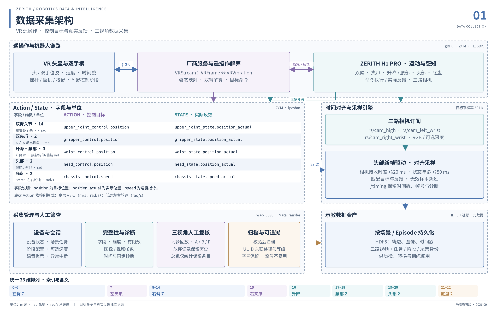
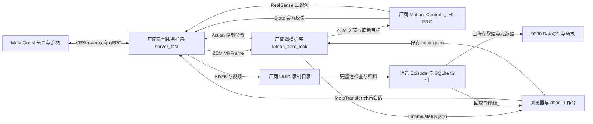

[](docs/collection-architecture.png)

# ZERITH H1 PRO 数据采集 · 开发者 README

## 机器人登录与核心地址

这台采集机器人的内网地址是 **`192.168.10.45`**，SSH 用户为 **`robot`**，端口 **`22`**。在能访问该内网的终端执行 `ssh robot@192.168.10.45`，按提示输入本机交接版 README 中的 SSH 登录密码。采集界面和下游质检都运行在这台机器上。[8090 采集工作台](http://192.168.10.45:8090/) · [9990 DataQC 质检工作台](http://192.168.10.45:9990/)

以下是 **`192.168.10.45` 的实际部署路径**，于 2026 年 11 月 26 日用服务配置、监听端口和进程入口复核。下方的 GitHub 源码链接使用仓库相对路径，可与此表对照。

| 核心模块 | 机器人上的绝对路径 | 查什么 |
| --- | --- | --- |
| **8090 采集网页** | `/home/robot/collection_web/`，服务从 `/home/robot/collection_web/start.sh` 进入 `/home/robot/collection_web/app.py` | 用户服务 `zerith-collection-web.service`。提交会话查 `collector.py`，厂商 RPC 查 `protocol.py`，归档和评级查 `episodes.py`。前端入口为 `/home/robot/collection_web/static/index.html`。 |
| **锁腰、锁头与固定高度** | `/home/robot/teleop_zero_lock/patch/zero_lock.py`、`/home/robot/teleop_zero_lock/patch/pose_config.py`。运行入口 `/home/robot/teleop_zero_lock/runtime/teleop_zero_lock` | 已保存目标在 `/home/robot/teleop_zero_lock/config.json`，运行状态与实测在 `/home/robot/teleop_zero_lock/runtime/status.json`。逐帧验收用 `/home/robot/teleop_zero_lock/tools/analyze_recording.py`。 |
| **三路相机、采样与写盘** | `/home/robot/collection_depth_toggle/`。运行入口 `/home/robot/collection_depth_toggle/runtime/server_fast` | `timing.py` 负责匹配与拒帧，`rgb_mode.py` 切 RGB/RGB-D，`patch.py` 接入原厂写盘，`audio_cache.py` 缓存阶段提示音。原厂 gRPC 为 `192.168.10.45:50051`。 |
| **开机启动** | 源文件在 `/home/robot/collection_autostart/`。`robotd.service` 实际调用 `/usr/local/lib/zerith-collection-autostart/direct_boot.py` | 覆盖文件 `/etc/systemd/system/robotd.service.d/collection-direct-boot.conf`。生成脚本 `/run/zerith-collection-autostart/start_all_h1_tmux.sh`，启动诊断 `/run/zerith-collection-autostart/status.json`。 |
| **原厂进程及 SDK** | `/opt/robot/` 是 `robotd` 内的只读挂载，原厂入口 `server`、`teleop`，控制及状态进程 `Motion_Control`、`SDKService`、`robot_state` | 状态接口 `192.168.10.45:25120`，文件接口 `192.168.10.45:25128`。协议参考 `/home/robot/data_collection/robot.proto`，ZCM 定义 `/home/robot/H1_SDK_1.3.9/robot_SDK/include/ZCM_Data/`，相机 SDK `/home/robot/H1_SDK_1.3.9/camera_sdk_python/`。 |
| **采集数据、录像和索引** | `/data/zerith_data/` 保存原厂任务目录及按场景整理的 `episode_*`。`/home/robot/collection_web/runtime/` 保存网站索引和会话状态 | 采集索引 `/home/robot/collection_web/runtime/collection.sqlite3`。每条归档内有 `episode.hdf5`、`videos/rs/`、`collection_task.json`、`timing_quality.json` 和 `review.json`。 |
| **9990 DataQC、复核和导出** | `/home/robot/dataqc/unified-workbench/workbench.py`、`/home/robot/dataqc/unified-workbench/dataqc/worker.py` | 用户服务 `dataqc-web.service`、`dataqc-worker.service`。数值规则 `dataqc/checks.py`，动作与姿态 `dataqc/motion.py`、`dataqc/recorded_task.py`。实际运行目录为 `/home/robot/dataqc/unified-workbench/runtime/`，任务和报告位于其 `var/runs/`，导出位于其 `exports/`。 |

### 源码检出与配套项目

| 项目 | 这台机器上的位置 | 用途 |
| --- | --- | --- |
| 采集分支源码检出 | `/home/robot/zerith_idata_datacollection/` | `Edgardcai/zerith_idata` 的 `data_collection_new`。该目录是源码检出，线上 8090 和两个扩展从上表列出的独立目录启动。[采集分支](https://github.com/Edgardcai/zerith_idata/tree/data_collection_new) |
| 固定 RGB 与快速写入历史源码 | `/home/robot/zerith_idata_datacollection/collection_rgb_only/`、`/home/robot/zerith_idata_datacollection/collection_storage_fast/` | 历史实现和回滚链。当前常驻录制入口为 `collection_depth_toggle/runtime/server_fast`。 |
| DataQC 分支源码检出 | `/home/robot/dataqc/zerith_idata-release/dataqc/` | 同仓库 `dataqc` 分支在机器人上的源码副本。现场运行版本从 `/home/robot/dataqc/unified-workbench/` 确认。[DataQC 分支](https://github.com/Edgardcai/zerith_idata/tree/dataqc/dataqc) |
| 8080 H1 SDK 控制与推理录制 | `/home/robot/control/web_control/`，入口 `/home/robot/control/web_control/server.py` | 独立控制台，集中处理 SDK 控制、回放及推理录制。本次核对时 8080 用户服务处于停止状态。源码同一检出下的 `/home/robot/control/h1_sdk_common.py`、`/home/robot/control/read_robot_state.py`、`/home/robot/control/send_robot_command.py` 和 `/home/robot/control/inference_executor.py` 提供 SDK 工具。 |
| 语音助手与本地语音 | `/home/robot/control/voice_assistant/`、`/home/robot/control/chinese_speech/` | 独立模块。8090 的标定提示由浏览器播报，录制阶段提示音在录制进程侧缓存。 |
| 现场服务与配置 | 8090 和 9990 的用户服务均在 `/home/robot/.config/systemd/user/`，附属控制工程的配置在 `/home/robot/control/config/`、`/home/robot/control/systemd/` | 以 `systemctl show` 的 `FragmentPath`、`DropInPaths` 和 `WorkingDirectory` 确认实际生效文件。 |

如果 SSH 登录后 `/opt/robot` 显示为空，可通过正在运行的 `robotd` 查看其只读挂载。以下命令在机器人上执行。

```bash
robotd_pid=$(systemctl show robotd.service -p MainPID --value)
if [ "$robotd_pid" -gt 0 ]; then
  sudo ls -l "/proc/$robotd_pid/root/opt/robot/"
fi
```

`Edgardcai/zerith_idata` 的 [`data_collection_new`](https://github.com/Edgardcai/zerith_idata/tree/data_collection_new) 分支在厂商 H1 PRO 1.3.9 的 VR 遥操和录制程序上增加固定姿态、三相机对齐和采集管理。本文按《01_数据采集架构》从 VR 输入、Action/State、采样引擎讲到归档。点击上方架构图可查看原尺寸。源码链接使用仓库相对路径。`/home/robot/...` 是 `192.168.10.45` 上的实际部署路径。

**定位问题时先确认是哪条链路。** `collection_web` 决定何时提交任务和归档。`teleop_zero_lock` 决定机器人怎样保持姿态。`collection_depth_toggle` 决定哪些相机帧、状态和命令进入 HDF5。质检的阈值、失败状态、证据和排查入口集中在 [采集质检与验收指标](docs/collection-quality.md)。

## 按架构图查代码

| 图中模块 | 主入口 | 对应质检或操作 |
| --- | --- | --- |
| 遥操作与机器人链路 | [`protocol.py`](collection_web/protocol.py)、[`zero_lock.py`](teleop_zero_lock/patch/zero_lock.py) | Quest 的 `VRStream`、原厂解算与控制总线。固定姿态检查反馈 `<=0.25 s`、初始化与四轴持续稳定。见[固定姿态实现](#固定头腰与升降柱)和[姿态验收阈值](docs/collection-quality.md#固定姿态验收)。 |
| Action / State 字段与单位 | 录制服务的 `Real_Env`，以及 [`Sampler.pick()`](collection_depth_toggle/timing.py#L207) | 控制目标和实际反馈分别取样。检查五组部件、字段列宽与有限值。见[23 维数据约定](#action-与-state-的-23-维约定)。 |
| 时间对齐与采样引擎 | [`timing.py`](collection_depth_toggle/timing.py)、[`patch.py`](collection_depth_toggle/patch.py) | 头部新帧驱动，默认 `30 Hz`。相机接收差 `<=20 ms`，State 年龄 `<=50 ms`。见[匹配和拒帧规则](docs/collection-quality.md#在线采样质检)。 |
| 设备与会话 | [`device_monitor.py`](collection_web/device_monitor.py)、[`collector.py`](collection_web/collector.py) | 核对 `23` 个电机、`5` 路通信、`3` 路相机、VR、模式、初始化、存储及正在写入的会话。见[启动前质检](docs/collection-quality.md#启动前质检)。 |
| 完整性与诊断 | [`validate_finished()`](collection_web/episodes.py#L136)、[`timing_quality()`](collection_web/episodes.py#L36) | 结束标志、HDF5 结构、帧数、三路文件、时序诊断。`30 Hz` 下相邻主时间超过 `50 ms` 告警。见[落盘规则](docs/collection-quality.md#落盘完整性与时序质检)。 |
| 三视角人工复核 | [`review.js`](collection_web/static/review.js)、[`app.py`](collection_web/app.py) | 同步浏览三路录像、人工 A/B/F、按 UUID 查路径。见[人工复核与回放](docs/collection-quality.md#人工复核与三路回放)。 |
| 归档与可追溯、示教数据资产 | [`EpisodeStore`](collection_web/episodes.py)、同仓库 [`dataqc`](https://github.com/Edgardcai/zerith_idata/tree/dataqc/dataqc) | 按场景增长编号并保存 UUID、任务、时序和等级。下游逐帧解码、复核动作与转换结果。见[归档格式](#数据结构与归档)和[下游 DataQC](docs/collection-quality.md#下游-dataqc)。 |

## 阅读索引

- [机器人登录与核心地址](#机器人登录与核心地址)
- [源码检出与配套项目](#源码检出与配套项目)
- [系统和端口](#系统和端口)
- [代码目录与入口](#代码目录与入口)
- [原厂接口和封装方式](#原厂接口和封装方式)
- [固定头腰与升降柱](#固定头腰与升降柱)
- [从网页操作到一条录制](#从网页操作到一条录制)
- [数据结构与归档](#数据结构与归档)
- [现场排查](#现场排查)
- [二次开发与测试](#二次开发与测试)
- [完整质检指标和二次开发边界](docs/collection-quality.md)

## 系统和端口



| 地址或通道 | 提供者 / 使用者 | 用途与入口 |
| --- | --- | --- |
| [采集工作台](http://192.168.10.45:8090/) | `zerith-collection-web.service` → `/home/robot/collection_web/start.sh` → `app.py` | 提示词、场景、设备检查、会话、固定姿态配置、录像复核。服务模板在 [`collection_web/deploy/`](collection_web/deploy/zerith-collection-web.service)。 |
| `192.168.10.45:50051`（机器内调用 `127.0.0.1:50051`） | 机器人上的 `server_fast`。网页 `protocol.py` 连接本机，Quest 连接机器人的对应 gRPC 服务 | `MetaTransfer` 提交录制会话，`DeviceStatusStream` 订阅状态，`VRStream` 传姿态与手柄事件，`ControlVideo` 用于 WebRTC 视频信令。 |
| `http://192.168.10.45:25120/`（机器内调用 `127.0.0.1:25120`） | 厂商状态服务 → `DeviceMonitor` | 工作台读取 `/motor`、`/communication_board`、`/system_init`、`/control_mode`、`/battery`。 |
| `http://192.168.10.45:25128/` | 厂商 `server` 自带的 HTTP 文件服务，由录制扩展保留 | 厂商文件接口。8090 的归档和回放由本地文件与 SQLite 实现。 |
| ZCM `ipcshm` | 录制进程、遥操进程、厂商控制与状态进程 | 本机共享内存消息。`VRFrame` 传入遥操，`*_control` 携带控制目标，`*_state` 携带实际反馈。网页只通过 `joint_observer` 订阅头腰反馈。 |
| [DataQC 工作台](http://192.168.10.45:9990/) | 同仓库 [`dataqc` 分支](https://github.com/Edgardcai/zerith_idata/tree/dataqc/dataqc) 的 `workbench.py` 和 worker | 下游 HDF5 质检、批量复核、视频解码、LeRobot 转换。读取已归档数据。 |
| `:8080` | [`web_control`](web_control/README.md) | 另一套 H1 SDK 控制工具，包含数值控制、机器人动作回放以及 SDK 推理录制。现场目录 `/home/robot/control/web_control/`，本次核对时 8080 停止。8090 的三路录像回放只播放媒体。 |

## 代码目录与入口

先确定要读的副本。机器人 `192.168.10.45` 的采集分支检出在 `/home/robot/zerith_idata_datacollection/`，实际进程从[核心部署表](#机器人登录与核心地址)的各自路径启动。

| 工程位置 | 职责 | 从哪里开始读 |
| --- | --- | --- |
| [`collection_web/`](collection_web/README.md) | 原生 HTML/JS 与 Python HTTP 服务 | [`app.py`](collection_web/app.py) 的 `Application` 组装状态、相机、遥操、采集会话和索引，`Handler` 分派 API。 |
| [`collection_web/static/`](collection_web/static) | 提示词、商品选择、进度、历史列表与三路回放 | [`app.js`](collection_web/static/app.js) 的 `task()`、`poll()`、`renderStages()`，[`task-prompts.js`](collection_web/static/task-prompts.js) 对应后端模板，[`product-picker.js`](collection_web/static/product-picker.js) 做搜索，[`review.js`](collection_web/static/review.js) 管理播放器。 |
| [`collection_web/tasks.py`](collection_web/tasks.py#L113) | 任务约束和元数据划分 | `compose_task()` 生成提示词和阶段。`validate_task()` 返回厂商 `config` 和网页 `targets`。 |
| [`collection_web/collector.py`](collection_web/collector.py#L74) | 场景、前置检查、会话、状态与文件监测 | `preflight()` → `start()` → `_receive()` 和 `_watch()` → `end()`。 |
| [`collection_web/episodes.py`](collection_web/episodes.py#L136) | 结构与时序质检、归档、编号、评级、放弃恢复 | `validate_finished()`、`timing_quality()`、`EpisodeStore.observe()`、`finalize()`、`episode_directory()`。 |
| [`collection_web/teleop_status.py`](collection_web/teleop_status.py#L19) | 网页的姿态配置和遥操状态 | `save()` 写配置，`snapshot()` 区分已保存配置、已应用配置和当前实测。 |
| [`collection_web/device_monitor.py`](collection_web/device_monitor.py#L12)、[`cameras.py`](collection_web/cameras.py) 与 [`joint_observer.cpp`](collection_web/joint_observer.cpp) | 设备健康、低频预览和头腰关节监视 | `DeviceMonitor.snapshot()`、`Cameras.set_enabled()`、`WaistState` / `HeadState` 订阅。 |
| [`teleop_zero_lock/`](teleop_zero_lock/README.md) | 固定腰、头和可选升降柱，接入原厂遥操生命周期 | [`patch/zero_lock.py`](teleop_zero_lock/patch/zero_lock.py) 是控制核心，[`patch/pose_config.py`](teleop_zero_lock/patch/pose_config.py) 是共享输入契约，[`tools/analyze_recording.py`](teleop_zero_lock/tools/analyze_recording.py) 是固定姿态离线验收。 |
| [`collection_depth_toggle/`](collection_depth_toggle/README.md) | 按会话切 RGB/RGB-D，按相机帧采样，复用原厂写盘 | [`rgb_mode.py`](collection_depth_toggle/rgb_mode.py)、[`timing.py`](collection_depth_toggle/timing.py)、[`patch.py`](collection_depth_toggle/patch.py)、[`audio_cache.py`](collection_depth_toggle/audio_cache.py)。 |
| [`collection_autostart/`](collection_autostart/README.md) | `robotd` 开机启动经过校验的两套扩展 | [`direct_boot.py`](collection_autostart/direct_boot.py) 校验原厂脚本并生成启动入口，[`boot_guard.py`](collection_autostart/boot_guard.py) 约束同一次启动只领取一次组件，[`manager.py`](collection_autostart/manager.py) 核对实时进程与状态。 |
| [`collection_rgb_only/`](collection_rgb_only/README.md)、[`collection_storage_fast/`](collection_storage_fast/README.md) | 历史固定 RGB、并行写入版本，供录制服务回滚链使用 | 对应模块的 `tools/` 与 README。当前 `server_fast` 的业务逻辑在 `collection_depth_toggle/`。 |
| [`read_robot_state.py`](read_robot_state.py)、[`send_robot_command.py`](send_robot_command.py)、[`h1_sdk_common.py`](h1_sdk_common.py) | H1 SDK 状态与数值控制工具 | [`CORE_GUIDE.md`](CORE_GUIDE.md)、[`CONTROL_README.md`](CONTROL_README.md)、[`H1_ARM_CAMERA_LIDAR_GUIDE.md`](H1_ARM_CAMERA_LIDAR_GUIDE.md)。[`voice_assistant/`](voice_assistant/README.md) 与 [`chinese_speech/`](chinese_speech/README.md) 是独立语音服务。 |

## 原厂接口和封装方式

在 `192.168.10.45` 上，协议参考为 `/home/robot/data_collection/robot.proto`。录制服务是 `/home/robot/collection_depth_toggle/runtime/server_fast`，提供 `192.168.10.45:50051`。原厂进程位于 `robotd` 内的 `/opt/robot/`。

### 三条独立的接口链

1. **任务接口。** [`protocol.py`](collection_web/protocol.py#L25) 用独立 Protobuf 描述符注册原厂消息的必要字段，保留字段号和线上的类型。`/robot.RobotService/MetaTransfer` 是一入多出。请求 `MetaRequest.json_config`（字段 1）装 JSON，响应每条 `MetaData.json_data`（字段 1）装原厂事件。网页传 `task_id`、`task_name`、`scene_id`、`subtask_num`、`max_episode_time`、`frequency`、场景和动作描述、`step_list`。`record_depth` 是当前录制扩展读取的附加配置。固定头腰/升降柱另走遥操配置文件。
2. **遥操接口。** 厂商 `RobotService.VRStream` 是双向流。Quest 上送 `VRFrame`，含头/双手的位姿与速度、摇杆、扳机、A/B/X/Y 按键和时间戳。录制服务将 `VRFrame` 放进 ZCM，总线上的原厂遥操控制器消费它。返回流是 `VRVibration`。同一份按键事件也供录制器判断 Y 的开始和分段。A 键的初始化、标定和启动遥操由遥操进程处理，Y 键的开始和分段由录制器处理。
3. **状态与视觉。** 工作台用 `DeviceStatusStream(status_format=3)` 读详细 JSON，并与 `:25120` 的五路状态合并。SDK `WaistState` / `HeadState` 支持网页侧只读观察。预览由 `camera_sdk_python.CameraClient(enable_depth=False)` 通过 gRPC 信令建立 WebRTC，网页再用 JPEG 对外提供最新帧。正式采集使用录制进程本地 `RsRecorder` 的帧和 ZCM 状态，独立于网页预览开关。

原厂接口证据可在机器人上的 `~/data_collection/robot.proto`、H1 1.3.9 SDK 的 `robot_SDK/include/ZCM_Data/` 和原厂 `server` 包内的 `robot_pb2` 核对。该机器上的归档描述符提供 `GetRecorderState`，现场参考 `.proto` 另列 `RecorderReinit` / `RecorderGetState`。依赖具体 RPC 前以目标二进制的描述符为准。已核验的 `SendControlCommand` 是系统控制枚举，包含急停、复位、丢弃重采。8090 正常采集和固定姿态使用上面三条链。

### 原厂程序如何复用

| 层 | 厂商实现 | 本项目接入方式 |
| --- | --- | --- |
| Web | 原厂 `RobotService` 和任务 JSON | 8090 自己维护会话与归档，用兼容的 gRPC 客户端持有原厂流。厂商 `MetaTransfer` 解析 JSON、构造 `EpisodeDataCollector`、启动线程并用异步队列回传事件，流退出时清理采集器。 |
| 遥操 | `teleop` 入口，`ZerithCtrl`、`HeadCtrl`、`ZerithWBC`、`CalibrationManager` | [`build_trial.py`](teleop_zero_lock/tools/build_trial.py#L23) 校验厂商原包 SHA 以及 Python 3.10，生成独立的 `teleop_zero_lock`，仅替换 `teleop` 入口归档项。启动时先加载原厂类，再由 `zero_lock.install()` 包装已核验的方法，最后启动同一个原厂 `TeleopController`。其余 643 个归档项字节相同。 |
| 录制 | `server` 入口、`RsRecorder`、`Real_Env`、`collect_data.EpisodeDataCollector` | [`tools/build.py`](collection_depth_toggle/tools/build.py) 只替换副本里的 `server` 入口，其余 1751 个归档项字节相同。[`tools/bootstrap.py`](collection_depth_toggle/tools/bootstrap.py#L55) 先安装相机、采样、写盘与提示音扩展，再启动原厂 `main()`。 |
| 开机 | `robotd.service` 与原厂 tmux 启动脚本 | `direct_boot.py` 从只读原厂脚本生成运行时脚本，校验厂商和自检通过的扩展包哈希。保留 `Motion_Control`、`SDKService` 与 `robot_state`。当前模板同时接入系统侧的 `robot-wifi-client-only`。 |

### 录制扩展的四组接入点

1. [`rgb_mode.install_service()`](collection_depth_toggle/rgb_mode.py#L124) 包装 `MetaTransfer`。同一时刻只接受一个会话，切换相机流并等到相机配置匹配、实际出帧后才进入原厂 RPC。`EpisodeDataCollector.__init__` 写入实际 `record_depth`。RPC 结束或失败后尝试恢复 RGB。
2. [`timing.install_cameras()`、`install_env()`、`install_collector()`](collection_depth_toggle/timing.py#L112) 接入原厂相机 worker、消息回调及录制采样循环。相机主机接收时间在 `wait_for_frames` 返回时记录，像素复制移到共享锁外。采样采用头部新 RGB 帧驱动，保留原厂设备检查、开始/结束、阶段与写盘流程。检查原厂关键方法的字节码摘要，布局变化时停止装载。
3. [`patch.ParallelBatch`](collection_depth_toggle/patch.py#L57) 预编码 BGR JPEG、并行预压缩 depth（原厂 zlib 等级 3），保留原厂单线程顺序写 HDF5、PyAV 写 H.264 MP4、命名与阶段帧索引。预处理失败时该批走原厂编码；采集版样本缺少 `_timing` 时拒绝写盘。阶段提示只记录边界，画面继续按正常批次写入，减小切阶段写入压力。
4. [`audio_cache.install()`](collection_depth_toggle/audio_cache.py#L51) 在创建采集器时预生成开始、完成和各阶段提示音，播报时复用音频数组。未缓存的厂商告警仍使用原语音路径。8090 的标定语音由浏览器 `speechSynthesis` 处理，属于另一条链。

## 固定头腰与升降柱

在 `192.168.10.45` 上先打开 `/home/robot/teleop_zero_lock/patch/zero_lock.py`。控制程序为 `/home/robot/teleop_zero_lock/runtime/teleop_zero_lock`，配置为 `/home/robot/teleop_zero_lock/config.json`，应用与实测查 `/home/robot/teleop_zero_lock/runtime/status.json`。

### 原厂局部能力与固定姿态任务的差异

以下结论对应本机用于构建的 H1 PRO 1.3.9 原厂 `teleop` 和 `server`。核对了部署副本中的原厂类方法和录制器订阅。不同厂商版本须重新核对。

| 原厂实现 | 对固定姿态录制的影响 |
| --- | --- |
| `RobotService.MetaTransfer()` 创建录制器。`Real_Env.get_action()`、`get_observation()` 分别把 ZCM 命令和反馈装进数据。 | 录制契约只知道任务、传感器与已有命令。在任务 JSON 加角度字段，原厂流程没有将其变成遥操设定的路径。 |
| `ZerithCtrl.toggle_waist_lock()` 的 X 键从 `waist_last_published` 锁住上次下发的腰部目标，解锁时使用原缓存过渡。 | 能保持当时的腰部目标。留存量取决于上次动作，缺少为本次会话显式设定四轴与可选高度的统一入口。 |
| `HeadCtrl.get_head_command()` 按头部跟随开关从自动跟随或摇杆手动得到头部命令。`TeleopController` 的解耦、过渡及遥操路径调用它并下发。 | 关闭跟随仍保留手动路径，头部行为和 X 锁腰独立。初始化 home 也只覆盖进入遥操前的过渡。 |
| `ZerithWBC.move_to_cartesian()` 使用原厂模型、`cfg`、`home_cfg` 做 IK，`send_control_cmd()` 还处理腰部缓存与 `height_offset`。 | 仅在发送时改角度，IK 仍可能把与胸腰几何相关的自由度用于到达目标。物理身体与求解所采用的姿态不一致时，同一组双臂关节值会落到不同的末端位置。改变高度也会改变双臂可达范围。 |
| `send_head_cmd()` 可下发给定角度和原厂增益。 | 指令恒定时，编码器反馈仍可能因头部重力、负载和摩擦产生偏差。原厂 X 锁腰也无法解决这部分误差。 |

因此本项目在**同一个遥操进程**里同时约束模型、初始化、持续控制输出及状态监测。保留厂商控制器与电机服务作为原有发布路径，避免网页额外开启 SDK 发布者。

### 配置生效的全过程

1. **保存契约。** 网页 `saveTeleop` → `POST /api/teleop/config` → [`TeleopStatus.save()`](collection_web/teleop_status.py#L70)。只允许已反初始化、状态可读且会话空闲时保存。运行状态一般要求 `status.json` 年龄小于 `3 s`，初始化过程中放宽到 `15 s`。`pose_config.validate_config()` 检查布尔、有限数和上下界，临时文件 `fsync` 后原子替换 `/home/robot/teleop_zero_lock/config.json`。`config` 是保存值，`applied_config` 是运行进程报告的当前应用值。
2. **按目标初始化。** [`zero_lock.install()` 的 `initialize()`](teleop_zero_lock/patch/zero_lock.py#L440) 在长按 A 触发原厂 `init()` 时读取配置，二次核对模型限位。把目标写入 `vr_home_pose`，用原厂插值执行腰部与升降柱回位。腰部过渡按设计限制峰值约 `0.15 rad/s`。原厂初始化结束后，`ZeroPolicy.arm()` 要求反馈可用且两轴腰部误差不大于 `0.03 rad`。头部从实际位置平滑过渡，目标速度上界约 `0.03 rad/s`。
3. **在模型里固定。** [`freeze_model()`](teleop_zero_lock/patch/zero_lock.py#L35) 保留原厂 VR 模型 19 变量布局。对腰 pitch/yaw、头 yaw/pitch（内部下标 `1, 2, 17, 18`）将目标位姿折入父坐标变换，再把关节运动轴置零。可选升降柱使用内部下标 `0`。真实模型与按操作者人体比例缩放的模型均如此。固定角度的 FK 与 Jacobian 一致，重标定时从基础模型重建，避免重复叠加。实际反馈所用的 FK 与独立 `HIGH_LEVEL` 模型沿用原厂。
4. **在发送时保持。** [`send_control()`](teleop_zero_lock/patch/zero_lock.py#L514) 约束规划位置并将固定轴速度、加速度归零。开了固定升降柱时，清除遥操 `height_offset` 并同步 X 锁定缓存。[`GuardedBus.publish()`](teleop_zero_lock/patch/zero_lock.py#L306) 在原厂发送 `waist_control`、`head_control` 前再次约束。暂停、恢复、重标定也继承同一姿态。关闭固定升降柱时，升降自由度回到原厂行为，四个头腰角仍使用配置。
5. **物理反馈与故障分开。** [`ZeroPolicy.head_feedforward()`](teleop_zero_lock/patch/zero_lock.py#L214) 用 URDF 动力学及已测腰/头角度计算有界补偿，原厂 KP/KD 保持。当前上限 `±0.6 N·m`，补偿变化率 `0.05 N·m/s`，积分上限 `±0.15 N·m`。头部总线顺序按 H1 PRO 原始 yaw/pitch，修正原厂内部属性交换。偏差告警独立于故障处理。反馈过期、无效或电机错误时，原厂保护仍先运行，遥操扩展会保持故障并暂停适用的遥操状态。反初始化或离开 VR 模式时解除约束。标定等待跟踪实际模式 `0`、初始化 `2`，切走后退出等待。
6. **留痕与验证。** 遥操进程把目标、真实反馈、`ready`、`fault` 和当前应用配置写入 `runtime/status.json`。`Collector.start()` 将当时应用的固定姿态快照写入 `targets.fixed_pose`，每条归档复制这个**会话开始时**的快照。逐帧高度、头腰真实值和命令由录制器按原厂语义写入 HDF5，可据此检查整个 episode。

| 字段顺序 | 网页配置项 | 可保存范围 |
| --- | --- | --- |
| 1 | `waist_pitch_rad` | `0` 至 `1.309 rad` |
| 2 | `waist_yaw_rad` | `-0.9` 至 `0.9 rad` |
| 3 | `head_yaw_rad` | `-1.5708` 至 `1.5708 rad` |
| 4 | `head_pitch_rad` | `-0.7854` 至 `0.5236 rad` |
| 可选升降 | `lift_enabled`、`lift_height_m` | `0` 至 `0.8 m`，由 `lift_enabled` 决定是否保持 |

头部设定是上身坐标系内的关节角。腰 pitch 为 `0.3 rad` 且头 pitch 为 `0` 时，头部会随上身倾斜。**任务表单的 `lift_height` 是高度标签**，只写 `targets`。**姿态面板的 `lift_height_m` 是升降目标**，在 A 初始化阶段应用。进入录制会话时不会重新移动升降柱。界面 `ready` 与厂商 `system_init`、采集 `waiting` 以及标定状态分别表示不同事项，见[固定姿态质检](docs/collection-quality.md#固定姿态验收)。

## 从网页操作到一条录制

浏览器访问 [192.168.10.45:8090](http://192.168.10.45:8090/)。SSH 登录后，网页与会话的入口分别是 `/home/robot/collection_web/app.py` 和 `/home/robot/collection_web/collector.py`。采样代码从 `/home/robot/collection_depth_toggle/timing.py` 读起。

| 操作 | 调用位置 | 发生的事 |
| --- | --- | --- |
| 打开工作台 | `GET /api/bootstrap`、`GET /api/status?compact=1` | 加载同源页面、表单默认值、持久化的场景与会话状态。状态和分组定期轮询，旧响应不能覆盖新结果。写请求带 `X-Collection-Token`，浏览器重启令牌失效时重取后最多重试一次。 |
| 应用日期/场景 | `POST /api/scene/apply` → `Collector.apply_scene()` | 日期默认按 `Asia/Shanghai` 当天 `YYYYMMDD`，场景从 1 起。创建或选中 `日期_scene编号`，持久化到 `selected_scene.json`。场景可包含多个不同提示词。 |
| 选择任务 | `static/task-prompts.js` → `tasks.compose_task()` / `validate_task()` | 后端复算提示词和阶段，防止浏览器与任务版本不一致。货架抓取与放置为单手 1 阶段、双手 2 阶段；桌面取放为单手 2、双手 4；冰箱抓取仅单手 1 阶段。左、右产品和每阶段文本写入 `targets`，`action_desc` 按阶段写入厂商配置，`step_list=[]` 保持原厂约定。 |
| 设备检测 | `POST /api/preflight` → `Collector.preflight()` | 校验设备、目录与空间、最近是否已有写入。详细条件见[启动前质检](docs/collection-quality.md#启动前质检)。`/api/task/directory` 可查看解析后的源/目标路径。 |
| 启动采集 | `POST /api/session/start` → `Collector.start()` → `Vendor.meta()` | 复检场景、设备和存储，记录本会话开始前已经存在的目录作为 `baseline`。网页创建本地会话并建立 `MetaTransfer`，服务端切换相机模式并准备录制线程。 |
| 等待厂商接收 | `Collector._receive()` / `_watch()` | 响应写入 `meta_<会话ID>.jsonl`。采用同会话新生成且关键值匹配的厂商 `task_meta.json` 作为业务接受依据。确认后页面从 `connecting` 进入 `waiting`。录制与保存由当前条目状态呈现，后端会话仍可用于下一条。 |
| 长按 Y、短按 Y | 原厂 `EpisodeDataCollector._run_loop()` / `_capture_episode()` | 长按确认后创建单条 UUID 录制。录制中短按完成当前阶段，最后一段结束后写盘。网页合并同 UUID 的 `EPISODE_PROGRESS` 以及 `collection.log`，显示阶段、帧数和耗时。 |
| 保存完成 | `EpisodeStore.observe()` → `validate_finished()` → `finalize()` | 增量读取完整日志行。收到 `采集流结束` 标记后才读 HDF5，校验后移入场景目录，写任务、评级、时序结果。完整性失败会保留待查/重试状态。 |
| 复核 | `GET /api/review/<id>`、`GET/HEAD /api/video/<id>/<视角>` | 按 UUID 找已保存媒体，通过 HTTP Range 播放，并提供三路同步浏览、失败重试和人工 A/B/F。 |
| 结束会话 | `POST /api/session/end` → `Collector.end()` | 确认无写入和待保存记录后取消 RPC 并回收连接。只清理符合检查条件的本会话空临时目录，保留历史与其它文件。断流会显示 `disconnected`，避免盲目重发并重复建任务。 |

表单频率默认 `30 Hz`，验证范围 `1–60 Hz`。目标高于相机源频率时采样器不会制造补帧。最长时长默认 `1000 s`、范围 `1–1200 s`，阶段数范围 `1–20`。提示词受原厂目录名约束，禁止路径分隔符、NUL 和换行，最终限制 `230 UTF-8` 字节。`/api/cameras` 控制网页预览，实际录制深度选项在任务里提交。参见 [`collection_web/README.md`](collection_web/README.md)。

### 提示词与阶段契约

| 模式 | `prompt_mode` | 单手 / 双手阶段 | 双手完整流程或单手约束 |
| --- | --- | --- | --- |
| 货架抓取 | `shelf_grasp` | 1 / 2 | 左手抓货，保持左手所抓物品，右手抓货。 |
| 桌面取放 | `tabletop` | 2 / 4 | 左放、右放、左取、右取。单手时为该手先放后取。 |
| 货架放置 | `shelf_place` | 1 / 2 | 左手先放，右手后放。 |
| 冰箱抓取 | `fridge_grasp` | 1 / 不支持 | 左手或右手单选。英语模板为 `Open the warming cabinet door and grasp <商品>`。手别单独保存在 `targets.hand_mode`。 |

浏览器的商品目录和搜索接受中英文标签，发给厂商的是英文名。`compose_task()` 核对受支持模式、手别、ASCII 商品及退休商品名。`validate_task()` 用相同输入重新生成提示词和阶段数，提交不一致时拒绝。正在执行的会话刷新后恢复其原配置。升级提示词后以可复现实例核对网页、`MetaTransfer.json_config.action_desc` 和已归档的 `collection_task.json`，旧录制保留原字段。

### 网页 API 定位

| 请求 | 返回或更新 | 入口 |
| --- | --- | --- |
| `GET /api/bootstrap`、`GET /api/status` | 令牌、默认任务、选中场景，以及设备、采集、预览、遥操的合并状态 | `app.py` 的 `Application.status()`，以及 `static/app.js` 的初始化和轮询。 |
| `POST /api/task/parse`、`POST /api/task/directory`、`POST /api/scene/apply` | 解析旧提示词、生成源路径和归档路径、持久化当前场景 | `tasks.parse_targets()`，`Collector.task_paths()`、`apply_scene()`。 |
| `POST /api/preflight`、`POST /api/session/start`、`POST /api/session/end` | 检查并开始/结束唯一的任务会话 | `Collector.preflight()`、`start()`、`end()`。 |
| `POST /api/teleop/config`、`POST /api/cameras`、`GET /api/camera/<视角>` | 存储固定姿态配置、开关预览及获取 JPEG | `TeleopStatus.save()` 和 `Cameras`。相机有 `head`、`left`、`right`。 |
| `GET /api/episode-groups`、`GET /api/episodes`、`GET /api/episode-location/<id>` | 场景分组、条目列表和按 UUID 重新定位的数据路径 | `EpisodeStore.groups()`、`list()` 和 `location()`。 |
| `GET /api/review/<id>`、`GET/HEAD /api/video/<id>/<视角>` | 录像可用信息、分段读取 MP4 | `app.py` 的 `Handler.do_GET()`、`stream_file()`。 |
| `POST /api/episode/rate`、`POST /api/episode/delete` | 保存人工 A/B/F，或确认放弃 | `EpisodeStore.rate()`、`delete()` 及恢复审计。 |

## 数据结构与归档

在 `192.168.10.45` 上，原始和归档数据都在 `/data/zerith_data/`，8090 的索引为 `/home/robot/collection_web/runtime/collection.sqlite3`，归档与校验入口为 `/home/robot/collection_web/episodes.py`。

### Action 与 State 的 23 维约定

HDF5 原始数据按部件分组。下表的 23 维顺序用于需要拼接的转换与回放，仓库的 [`web_control/replay_controller.py`](web_control/replay_controller.py#L195) 可交叉核对。遥操模型内部 19 维下标属于另一套布局。

| 拼接下标 | 数据与单位 | Action 的 ZCM 源 | State 的 ZCM 源 | HDF5 字段后缀 |
| --- | --- | --- | --- | --- |
| `0–6`、`8–14` | 左、右臂各 7 个关节，rad | `upper_joint_control.position` | `upper_joint_state.position_actual` | `arm/position`，14 列 |
| `7`、`15` | 左、右夹爪电机角，rad | `gripper_control.position` | `gripper_state.position_actual` | `effector/position`，2 列 |
| `16`、`17–18` | 升降 m、腰 pitch/yaw rad | `waist_control.position` | `waist_state.position_actual` | `waist/position`，3 列 |
| `19–20` | 头 yaw/pitch，rad | `head_control.position` | `head_state.position_actual` | `head/position`，2 列 |
| `21–22` | 底盘两个速度维度，按命令模式解释 | `chassis_control.speed` | `chassis_state.speed_actual` | `base/velocity`，2 列 |

Action 前缀为 `action/`，State 为 `observation/state/`。State 的底盘反馈是左右轮速 `rad/s`。原厂 VR 路径的底盘 Action 可表达线/角速度 `(m/s, rad/s)`，低层命令也可能采用左右轮速。转换时保留来源和模式语义，不能只看 `[N,2]` 推出单位。厂商格式还可含关节速度/力矩、手和相机位姿、图像及阶段索引。Action 保存参考帧前最近接收的命令，`/timing` 明确记录其语义。轴偏差使用 State 与目标计算。

### 文件与身份

```text
/data/zerith_data/
  <task_id>_<task_name>/
    task_meta.json                    # 原厂会话确认
    <32 位 UUID>/                     # 活动录制目录
  <task_id>_scene<scene_id>/
    episode_000001/
      episode.hdf5                    # Action、State、图像、timestamp 与 timing
      episode_meta.json               # 厂商 UUID、阶段区间、采集身份等
      collection.log                  # 采集器日志
      collection_task.json            # 原任务、targets、来源和归档场景
      timing_quality.json             # 结构可读后的时序质检结果
      review.json                     # UUID、原编号、等级、reviewed、时序结果
      videos/rs/cam_high.mp4
      videos/rs/cam_left_wrist.mp4
      videos/rs/cam_right_wrist.mp4
/home/robot/collection_web/runtime/
  collection.sqlite3                  # sessions、episodes、audit、pending_deletions
  selected_scene.json
  session_<会话ID>.json
  meta_<会话ID>.jsonl
```

- SQLite 对同一场景的 UUID 和 `seq` 分别做唯一约束。序号取数据库与已有编号目录的最大值再增长，已放弃编号不复用。跨同一文件系统 `rename`，用 `finalizing` 中间状态支持重启恢复。原厂 UUID、阶段索引和 HDF5 内容随目录保留。
- 当归档被改名或搬到 `raw_data`，`episode_directory()` 根据 `review.json` 或 `episode_meta.json` 的 UUID 再定位。唯一结果可继续播放、评级和复制路径。多份同 UUID 的结果会报歧义，序号猜测不会用于决定真实文件。列表历史保留原场景、原编号。
- 三路回放以可用视角中的第一路为播放器时钟，采用共同进度和倍速。视频缓冲、漂移和解码异常由 [`review.js`](collection_web/static/review.js) 管理。采样同步与回放同步的指标分开，详见[质检说明](docs/collection-quality.md#人工复核与三路回放)。
- “放弃”会实际移除对应录制文件。删除前校验 UUID、路径边界、设备和 inode。先登记删除意图、移动到同父目录隔离路径，再删除，可恢复中断操作。记录保留 `deleted` 状态及审计历史，分组保留数排除 `deleted` 和 `deleting`。A/B/F 只统计完成记录。

## 现场排查

先用 `ssh robot@192.168.10.45` 进入机器人。8090 用户服务、`robotd`、以及 9990 的 `dataqc-web` / `dataqc-worker` 分开查。

这些命令从机器人主机执行。故障定位可以先读进程、状态、日志以及已完成的 episode。

```bash
systemctl --user status zerith-collection-web.service --no-pager
journalctl --user -u zerith-collection-web.service -n 100 --no-pager
systemctl show robotd.service -p MainPID -p ExecStart -p DropInPaths
systemctl --user show dataqc-web.service dataqc-worker.service -p ActiveState -p WorkingDirectory -p FragmentPath
ss -lnt '( sport = :8090 or sport = :9990 or sport = :50051 or sport = :25120 or sport = :25128 )'
curl -fsS 'http://127.0.0.1:8090/api/status?compact=1' | python3 -m json.tool
python3 -m json.tool /home/robot/teleop_zero_lock/runtime/status.json
```

| 现象 | 先看 | 接着核对 |
| --- | --- | --- |
| 8090 打不开 | 用户服务、`start.sh`、工作目录、8090 监听 | Python 虚拟环境、`joint_observer` 编译、SDK 头文件、`libzcm`、`teleop_zero_lock/patch/pose_config.py` 是否在网页目录的相邻工程中。 |
| 设备检测不通过 | `device.checks` 每个检查的 `key`、`detail` | 50051 状态流、25120 对应只读状态、五路通信板错误码、23 个电机、三路相机名称、`control_mode=0`、`system_init=2`。 |
| 姿态保存被拒或重启后旧高度 | `config`、`applied_config`、`phase`、`pose_config_supported` | `TeleopStatus.save()` 是否要求先结束会话和反初始化。配置已保存后，检查新一轮 A 初始化、实际 teleop PID 与状态文件新鲜度。 |
| 机械姿态有误差 | `target_rad` 与 `actual_rad`、`lift_target_m` 与 `lift_actual_m`、`reason`、`fault` | 看头 yaw/pitch 顺序、反馈新鲜度、是否处于过渡、重力补偿状态。对已完成录制分别统计 Action 与 State。 |
| 一直 `connecting` 或 gRPC `ALREADY_EXISTS` | `meta_<会话ID>.jsonl`、原厂 `task_meta.json` 与采集服务日志 | 检查其它采集客户端是否持有流，配置、`mtime`、场景号、频率和 `record_depth` 是否匹配。 |
| `waiting`，按 Y 后没有录制 | `collection.phase` 与 `teleop.phase`、Quest 连接和按键 | `waiting` 表示会话已接受。核对标定/遥操状态、原厂 `_run_loop()`、所需相机帧和磁盘检查。 |
| 在阶段间卡住或录制提前结束 | `collection.log`、RPC 响应、`/timing` | 检查同 UUID 阶段事件、`EPISODE_PROGRESS`、截止时长和样本拒绝原因。连续缺少可对齐的帧会结束本条。 |
| 停在 `saving` | 是否出现 `采集流结束`，以及 `episodes.detail.error` | `total_frames`、数组形状、深度属性、MP4 是否完整落地、源/目标是否同文件系统、是否已有顺序编号目录冲突。 |
| `completed` 但提示时序不合格 | `timing_quality.json` 的 `reasons`、`sample_stats`、`source_events` | 查 `/timing` 中具体相机、候选拒绝对应的头部帧、状态年龄和实际间隔。默认 A 与时序质检是两个字段。 |
| 三路回放只出一路或找不到 | `/api/review/<id>` 的各路返回、`/api/episode-location/<id>` | UUID 是否唯一，设备是否支持 H.264 解码，视频 Range 响应，文件是否非空以及是否被归档改名。 |
| 9990 提示腰头零位异常，但 8090 数据姿态正常 | `targets.fixed_pose.target_rad` 与 9990 的 `posture_state` / `posture_action` | 检查 `prompt_mode`、`fixed_pose.config`、质检版本及 `recorded_task_policy`。桌面目标姿态规则与零位规则的适用条件见[下游规则](docs/collection-quality.md#下游-dataqc)。 |

## 二次开发与测试

### 改动从哪个入口开始

| 要改什么 | 同步修改或核对 | 回归入口 |
| --- | --- | --- |
| 新增 SKU、提示词、单双手或阶段规则 | `static/app.js` 的商品列表，`static/task-prompts.js`，`tasks.py`，`static/index.html`。确保两端生成一致，阶段变化能追到 RPC 与元数据。 | [`test_prompt_templates.py`](collection_web/tests/test_prompt_templates.py)、`browser_prompt_modes.py`、`browser_catalog_batch4.py` |
| 改设备检查或场景/会话 | `device_monitor.py`、`collector.py`、`protocol.py`、`app.py`。保留断线和旧会话恢复语义。 | [`test_collector.py`](collection_web/tests/test_collector.py)、`test_http.py`、`browser_scene_directory.py` |
| 改姿态参数或限位 | `pose_config.py`、`zero_lock.py`、`teleop_status.py`、表单上下界与 `analyze_recording.py`。同时检查初始姿态、真实/缩放 IK、最终总线、反馈与训练数据的角轴顺序。 | [`test_policy.py`](teleop_zero_lock/tests/test_policy.py)、[`probe_model.py`](teleop_zero_lock/tests/probe_model.py)、`test_teleop_status.py`、`test_recording_pose.py`、`browser_fixed_pose.py` |
| 改相机、采样或时序 | `rgb_mode.py`、`timing.py`、`patch.py`、`episodes.py`。更新采样与质检阈值的两处实现、元数据版本、源时间语义和旧格式兼容策略。 | [`timing_self_test.py`](collection_depth_toggle/tests/timing_self_test.py)、`stability_self_test.py`、[`test_timing_quality.py`](collection_web/tests/test_timing_quality.py) |
| 改保存、编号、评级、放弃 | `episodes.py` 的 SQL、UUID、`finalize()`、`recover()`、删除审计与页面列表过滤。增加重复、任务重启、目录改名和半完成状态的覆盖。 | `test_episode_lifecycle.py`、`test_missing_records.py`、`browser_grade_paths.py`、`browser_lifecycle.py` |
| 改播放或预览 | `review.js`、`cameras.py`、`app.py` 的 `/api/review` 和 `stream_file()`，分别检查实时线程和历史播放会话。 | `test_video_review.py`、`browser_video_review.py`，后者生成临时 H.264 视频 |
| 升级厂商版本或开机 | `teleop_zero_lock/tools/build_trial.py`、`collection_depth_toggle/tools/build.py`、`collection_autostart/`。重新核对原厂 Protobuf、归档 SHA、方法字节码、闭包及位置数组，再构建候选包。 | `test_direct_boot.py`、`test_manager.py`、`test_upgrade.py`、两种候选包精确 SHA 离线自检 |

### 运行回归

在 Linux 工作区内使用 Python 3.10。网页依赖见 [`collection_web/requirements.txt`](collection_web/requirements.txt)，测试另需 `pytest`。Node 在 `PATH` 时执行前后端提示词一致性用例。

```bash
# 从仓库根目录执行。单元测试使用临时目录、模拟状态与本地模拟 gRPC。
PYTHONPATH="$PWD/collection_web" python3.10 -m pytest -q collection_web/tests collection_autostart/tests
python3.10 -m pytest -q teleop_zero_lock/tests
node --check collection_web/static/app.js
node --check collection_web/static/review.js
```

`collection_web/tests/browser_*.py` 是单独运行的 Playwright 脚本。运行前检查脚本指定的本地 Chromium 路径。`browser_video_review.py` 还需要可用的 FFmpeg `libx264`。浏览器回归运行隔离 HTTP 服务、临时 SQLite 和生成式测试媒体，不提交真机任务。

### 构建候选包与部署边界

- **只开发网页。** H1 相机预览运行依赖厂商 `camera_sdk_python`，设备监控 C++ 观察器需要 g++、SDK ZCM 头文件及 `pkg-config zcm`。`start.sh` 会在缺少观察器或源码更新时编译。`teleop_status.py` 仅加载相邻 `teleop_zero_lock/patch/pose_config.py` 的标准库校验。部署需要按既有目录布局提供这些依赖。
- **改遥操。** 使用 [`build_trial.py`](teleop_zero_lock/tools/build_trial.py) 指定匹配的 `--vendor` 和单独的候选输出，按模块说明运行 `--offline-self-test`。构建还会读取机器上 `/home/robot/collection_autostart/boot_guard.py`。自检使用内存总线，真实 ZCM 构造被禁用。候选包、哈希描述和验证标记要对应。现场切换流程由 [`preflight.py`](teleop_zero_lock/tools/preflight.py)、[`switch_trial.py`](teleop_zero_lock/tools/switch_trial.py)、[`upgrade_trial.py`](teleop_zero_lock/tools/upgrade_trial.py) 管理。
- **改录制。** 按 [`collection_depth_toggle/README.md`](collection_depth_toggle/README.md) 传入匹配的厂商 `server`，在独立工作区生成 `server_fast_candidate`。离线自检使用 `ZERITH_TEST_EPISODE` 指定已完成 HDF5，覆盖 RGB/RGB-D、原厂 writer、时间对齐、提示音与写入压力。旧版本的临时切换、候选激活和开机直启入口各自有检查条件。设备上实际入口通过 `systemctl show robotd.service` 与启动清单确认。
- **验收时分开记录。** Git 提交核对网页和源码，`runtime/build.json`、自检标记与 SHA 核对运行包。网页测试、候选包自检、真机姿态和逐条录制 QC 分别记录。提交 README 或应用源码变更后，部署端仍需按各组件入口取用相应版本。

采集文件、SQLite 索引、厂商二进制、运行包和机器配置由部署主机管理。Git 仓库提供代码、服务模板和构建工具。
