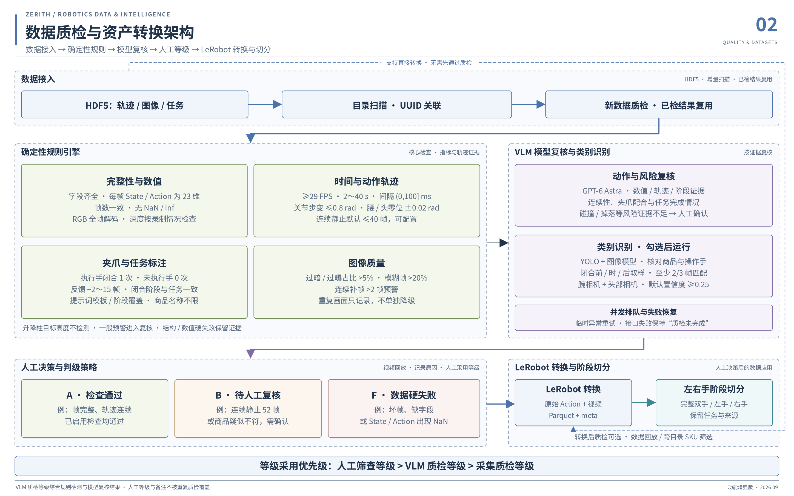
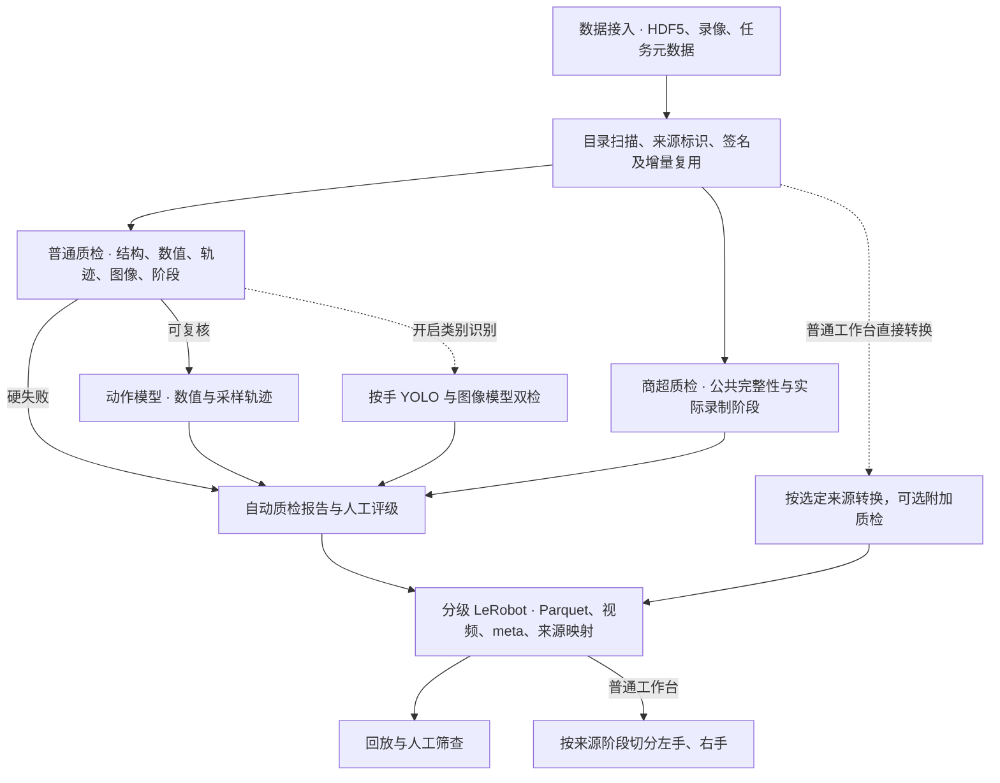

# 数据质检工作台开发者手册

[](docs/images/dataqc-architecture.png)

上图为 2026.09 的架构概览。下文按当前代码说明各模块和判级规则，具体差异见[架构与代码对照](#architecture)。

DataQC 在同一个 Web 工作台处理真机和仿真 HDF5 的扫描、规则质检、模型复核、人工评级、三视角回放、LeRobot 转换及切分。商超录制使用一套按实际录制阶段运行的质检和导出管线。项目在 GitHub `dataqc` 分支的 `dataqc/` 目录，本文所有相对路径均从这里开始，默认 Web 端口为 `9990`。

- [架构图与代码对应关系](#architecture)
- [功能入口与文件导航](#entrypoints)
- [数据接入与 23 维字段](#input)
- [普通真机和仿真质检指标](#rules)
- [动作模型、类别复核与请求队列](#models)
- [判级、人工决策和缓存](#grades)
- [商超录制质检](#market)
- [LeRobot 转换、校验、切分与回放](#export)
- [开发环境与部署](#setup)
- [故障排查](#debug)
- [二次开发与回归测试](#extend)

<a name="architecture"></a>
## 1. 架构图与代码对应关系

下图沿用《数据质检与资产转换架构》（2026.09，第 02 页）的五段流程，并标明当前实现中的普通质检、商超质检和直接转换分支。本文指标以代码中的检查项、默认值和实际调用链为准。



| 架构框 | 从哪个文件读起 | 当前实现 |
|---|---|---|
| 数据接入 / 目录扫描 / 结果复用 | [读取器](dataqc/io.py)、[仿真适配](dataqc/simulation.py)、[增量策略](dataqc/incremental.py)、[商超扫描](dataqc/market.py) | 普通链路按目录和文件指纹关联，商超兼用录制 UUID 与文件签名。两条链路各自判断结果是否可复用。 |
| 确定性规则 | [公共检查](dataqc/checks.py)、[动作与姿态](dataqc/motion.py)、[深度解码](dataqc/depth.py)、[桌面任务](dataqc/recorded_task.py) | 图中的提示词格式和普通任务夹爪次数现为信息用途。腰头默认零位，桌面任务有合法采集目标时按目标姿态核对。 |
| 动作复核、类别识别与失败恢复 | [动作证据](dataqc/motion_review.py)、[类别双检](dataqc/yolo_gate.py)、[综合决策](dataqc/assessment.py)、[请求队列](dataqc/gateway_queue.py) | 当前动作模型默认 `gpt-6.1-sol`。类别开关默认关闭，启用后要求每手 YOLO 与图像模型都通过。 |
| 人工决策 | [等级来源](dataqc/grade_policy.py)、[旧报告投影](dataqc/quality_policy.py)、[回放评级](integrations/replay_grades.py) | 人工等级优先，其次自动质检，再次采集等级。执行未完成、B 待复核与已接受的 B 各有独立状态。 |
| 转换及阶段切分 | [普通转换](dataqc/export.py)、[直接转换](dataqc/direct_export.py)、[商超任务](dataqc/market_job.py) | 普通工作台支持架构图的直接转换支路和左右手切分。商超页面在转换前先完成所选目录的增量质检，导出按真实阶段组织。 |

<a name="entrypoints"></a>
## 2. 功能入口与文件导航

[`workbench.py`](workbench.py) 是组合入口。FastAPI 挂载 `/auto` 和 `/market`，直接注册采集看板、YOLO 和 `/healthz`，其余请求由 `legacy_proxy()` 转入进程内临时端口的 Python HTTP Server。`load_legacy()` 装入 `pipeline_web_app.py`，再由 `integrations/legacy_ui.py` 按顺序接入兼容模块。修改普通首页前先确认页面来自旧 Handler 的 HTML 还是 `web/` 静态页面。独立 Worker 负责 `/auto` 数据库任务，商超与旧首页批量流程各有自己的执行入口。

| 功能与入口 | 接口、编排与存储 | 前端、渲染或兼容层 |
|---|---|---|
| 主工作台 `/` · 真机/仿真切换、扫描、概览、批量任务、静止帧处理、报告、删除 | [`pipeline_web_app.py`](legacy/scripts/embodied_data_pipeline-main/scripts/pipeline_web_app.py) 路由及任务步骤 · [`collection_defaults.py`](integrations/collection_defaults.py) 来源默认值 · [`overview.py`](integrations/overview.py) 概览 · [`batch_collection.py`](integrations/batch_collection.py) 批量预处理 · [`maintenance.py`](dataqc/maintenance.py) 维护操作 | [`legacy_ui.py`](integrations/legacy_ui.py)、[`collection_layout.py`](integrations/collection_layout.py)、[`review_assets/`](integrations/review_assets/)、[`web/raw-grade.js`](web/raw-grade.js)、[`web/qc-report.js`](web/qc-report.js) |
| 原始 HDF5 回放 · 三路流、曲线、逐帧数值、阶段、人工等级 | [`pipeline_web_app.py`](legacy/scripts/embodied_data_pipeline-main/scripts/pipeline_web_app.py)、[`replay_icra_episode.py`](legacy/scripts/embodied_data_pipeline-main/mcap_conversion/scripts/replay_icra_episode.py)、[`replay_grades.py`](integrations/replay_grades.py)、[`simulation_replay.py`](integrations/simulation_replay.py) | [`replay_stages.py`](integrations/replay_stages.py)、[`review_assets/replay.css`](integrations/review_assets/replay.css)、[`review_assets/grade-table.js`](integrations/review_assets/grade-table.js) |
| LeRobot 回放与人工筛查 · 数据集浏览、等级、备注、回放及筛选导出 | `/auto/lerobot` 使用 [`library.py`](dataqc/library.py) · 旧首页 LeRobot 标签使用 [`lerobot_manual_screening.py`](legacy/scripts/embodied_data_pipeline-main/lerobot_manual_screening.py) 及旧 Handler | [`web/library.js`](web/library.js)、[`replay_stages.py`](integrations/replay_stages.py)、[`compact_review.py`](integrations/compact_review.py) · SKU 定向筛选使用 [`sku_visualization.py`](integrations/sku_visualization.py) 与 [`sku_index.py`](dataqc/sku_index.py) |
| 仿真/真机跨平台对比 | [`library.py`](dataqc/library.py) `compare()` · [`lerobot_cross_platform.py`](legacy/scripts/embodied_data_pipeline-main/lerobot_cross_platform.py) 对齐和比较 · [`integrations/simulation.py`](integrations/simulation.py) 识别和切换仿真入口 | [`lerobot_cross_platform_web.py`](legacy/scripts/embodied_data_pipeline-main/lerobot_cross_platform_web.py)、[`web/library.js`](web/library.js) |
| 采集看板 `/collection-dashboard/` · 任务计划、统计、记录、CSV、视频 | [`collection_dashboard_api.py`](dataqc/collection_dashboard_api.py)、[`collection_dashboard.py`](dataqc/collection_dashboard.py)、[`collection_plans.py`](dataqc/collection_plans.py)、[`dashboard_grades.py`](dataqc/dashboard_grades.py)、[`dashboard_sync.py`](dataqc/dashboard_sync.py) | [`web/collection-dashboard.html`](web/collection-dashboard.html)、[`web/collection-dashboard.js`](web/collection-dashboard.js) · 业务字段见 [采集看板](docs/COLLECTION_DASHBOARD.md) |
| 商超 `/market/` · 全目录概览、所选目录质检、阶段评级、回放、分级转换 | [`market_api.py`](dataqc/market_api.py)、[`market.py`](dataqc/market.py)、[`market_job.py`](dataqc/market_job.py)、[`market_presentation.py`](dataqc/market_presentation.py) | [`market_ui.py`](integrations/market_ui.py)、[`market.html`](web/market.html)、[`market.js`](web/market.js)、[`market-workbench.js`](web/market-workbench.js)、[`market-replay.js`](web/market-replay.js) |
| 实时 YOLO `/#yolo` · 相机/上传、检测框、置信度、导出 | [`yolo_camera.py`](integrations/yolo_camera.py) 将 `/yolo/` 转给本机 `127.0.0.1:8787` 的相机工具。生产相机工具再调用本机 YOLO 推理服务（通常 `7881`）。 | `integrate_camera()` 管理嵌入页和分栏切换。浏览器相机使用 localhost 或 HTTPS。离线类别复核的模型配置走 [`yolo_settings.py`](integrations/yolo_settings.py) 与 [`yolo_gate.py`](dataqc/yolo_gate.py)。 |
| LeRobot 转换、复检和左右手切分 | [`manual_export.py`](integrations/manual_export.py)、[`direct_controls.py`](integrations/direct_controls.py)、[`conversion_job.py`](dataqc/conversion_job.py)、[`export.py`](dataqc/export.py)、[`direct_export.py`](dataqc/direct_export.py)、[`portable_quality.py`](dataqc/portable_quality.py) | 普通首页的转换/切分按钮接到旧 Handler。`/auto` 模式由 Worker 调用机器人适配器。 |
| CLI 质检、机器人适配与旧数据格式 | [`run_quality_pipeline.py`](legacy/scripts/embodied_data_pipeline-main/scripts/run_quality_pipeline.py)、[`zerith_rules.py`](integrations/zerith_rules.py)、[`robots.py`](dataqc/robots.py)、[`robot_profiles/`](legacy/scripts/embodied_data_pipeline-main/robot_profiles/) | 旧导入工具位于 [`mcap_conversion/`](legacy/scripts/embodied_data_pipeline-main/mcap_conversion/)；兼容目录中的相对路径由入口直接使用。 |

<a name="input"></a>
## 3. 数据接入与 23 维字段

### 3.1 从原始目录到统一读取器

| 数据类型 | 入口与文件 | 读取约定 |
|---|---|---|
| 普通真机 | `DATAQC_REAL_ROOT` 默认 `/data/zerith_data` · 每条 `episode.hdf5`、`episode_meta.json`、`collection_task.json`、`videos/rs/*.mp4` | `io.discover()` 递归发现，`io.load()` 读取 `observation/state` 和 `action`，将 `timestamp/t` 从毫秒转到秒。任务文本依次取 HDF5 `task_name`、采集配置 `config.task_name`、episode meta `task`。 |
| 仿真 | `DATAQC_SIM_ROOT` 默认 `/data/sim_data` · `states/aligned_joints.h5` 或 `.hdf5`、`meta/episode_meta.json` 和外部视频 | `simulation.read()` 核验 HDF5、JSON、视频引用、字段序和逐帧分量。仿真使用 `main_timestamp`，时间策略写入报告。与真机文件出现在同一条目录时读取器报错。 |
| 商超 | `DATAQC_MARKET_ROOT` 与 `DATAQC_MARKET_EXTRA_ROOTS` · 真机 HDF5 加 `episode_meta.json.step_index` | `market.discover()` 识别已知阶段、订单标识或 `market_recordings*` 来源。质检按当前显式提交的录制目录处理，浏览范围可以跨多个来源。 |

真机 `vectors()` 读取 14 维 `arm/position`、2 维 `effector/position`、3 维 `waist/position`、2 维 `head/position` 和 2 维 `base/velocity`，按 `NAMES` 重排。三路颜色相机固定为 `cam_high`、`cam_left_wrist`、`cam_right_wrist`。

| 零基列号 | 字段 | 调试时关注 |
|---|---|---|
| `0–6`、`8–14` | 左右臂各七关节 | 关节位置与相邻步变按 rad 解释。 |
| `7`、`15` | 左右夹爪 | 分别读取 Action 指令与 State 反馈。两侧列分开统计。 |
| `16` | `lift_m` 升降柱 | 单位 m，保留在状态、动作和来源中。当前普通质检停用目标高度判级。 |
| `17–20` | 腰俯仰、腰偏航、头偏航、头俯仰 | 单位 rad。姿态检查使用这里的列。 |
| `21–22` | `base_vx`、`base_wz` | 底盘线速度 m/s、角速度 rad/s。读取时同时关注是否实际采集。 |

对 `robot_station_inference` 或 `robot_station_order`，读取器要求 `timing/action_valid` 为与录制宽度对应的布尔 `(T,21)` 或 `(T,23)`，并验证有效位和动作有限性一致。声明底盘补零时还会检查补零值、有效位及新版 `timing/chassis_zero_filled`。老式明确声明未录底盘的 21 维数据可以补两列用于兼容读取，报告保留未采集标记。源动作未知值在导出和判级中保留其语义。字段表和目录实例见 [数据格式](docs/data-formats.md)。

<a name="rules"></a>
## 4. 普通真机和仿真质检指标

`checks.raw_checks()` 以 `io.load()` 的数据为起点，组装形如 `{key, label, status, detail, score_delta}` 的检查项。读取失败返回 `schema=fail`。`numeric_checks()` 在结构、有限性和时间戳长度足以安全分析时才执行后续轨迹检查。报告中的 `score` 从 100 加总扣分后截底，自动等级由硬失败、预警、复核结果和人工决策决定。`reporting.presentation()` 整理中文说明和可读证据，排查以 `raw_report.checks[].detail` 为先。

### 4.1 完整性、时间与动作轨迹

| 检查 key | 度量与边界 | 结果与排查证据 |
|---|---|---|
| `schema` | HDF5 能打开，必要字段能读，真机 `action/`、`observation/`、`timestamp/` 下每个数据集的首维等于 `T` | 缺字段、形状错误、首维不一致均为 `fail`。查 `error`、`length_mismatch`，对照相同录制版本的数据格式。 |
| `state` / `action` | 均为非空 `(T,23)` | 错误为 `fail`，证据 `shape`。加载器可能先以 `schema` 报出分部位错误。 |
| `finite` | State 和时间戳必须有限。有合法 `action_valid` 时，只允许掩码声明未知的 Action NaN，Action Inf 始终失败 | `fail`。`invalid_counts` 是总数，`invalid` 每种数组最多给 256 个坐标。报告序列化将非有限数写为 JSON `null`。 |
| `action_coverage` | 有掩码时，逐列统计有效帧。发现任意未知值则要求复核 | `warn` / `pass`，查 `unknown_values`、每列 `valid_frames/total_frames`。无掩码时，此项通常不生成。 |
| `timestamps` | 时间戳数与 `T` 一致，至少两帧。正常参考间隔 `1/30 s`，相邻差 `≤0` 或 `>0.1 s + 1e-7 s` 预警 | 数量不足或不一致为 `fail`。间隔异常为 `warn`，查 `gaps`、`bad_frames`，帧号记录变化后的一帧。 |
| `fps` / `duration` | `fps=(T-1)/(t[-1]-t[0])`，帧率至少 `29 fps`。时长应在闭区间 `[2,40] s` | 低 FPS 或超出时长为 `warn`。查 `actual`、`seconds`，先区分时钟/时间单位异常与实际采集过慢。 |
| `motion` / `joint` | 双臂 State 的 14 个关节相邻差绝对值。最大步变 `≤0.8 rad`，`joint` 另外要求全体步变均值 `≥0.0001 rad` | 超限或运动均值过小为 `warn`，查 `max_step`、`bad_frames`、`max_rad`、`mean_rad`。 |
| `arm_state_left/right`、`arm_action_left/right` | 分来源、分手记录相邻差 `>0.8 rad + 1e-7` 的关节 | `warn` 证据 `jumps` 含帧号、关节名、前值、后值及差。无有限差值为 `na`。 |
| `posture_state` / `posture_action` | 列 `17:21` 的每通道均值、Q01 和 Q99 都应落在目标 `±0.02 rad`，比较含 `1e-7` 浮点容差 | 超界为 `warn`。`bad_frames` 提供逐帧偏差的位置，判定取均值和分位数。全通道无数据为 `na`。 |
| `stationary` | 相邻帧 State 和 Action 各列最大绝对差都 `≤0.01`，相邻两端两种来源的底盘绝对速度最大值也都 `≤0.0001`。连续段为半开区间 `[start,end)`，帧数严格大于 `stationary_frames` 才预警 | 默认阈值 `40`，所以连续 40 帧仍通过，41 帧起预警。查 `max_frames`、`intervals`。Action 存在非有限值时，该项为 `na`。 |

### 4.2 夹爪、任务和阶段

- `gripper` 衡量活动幅度。任一手的 State 或有限 Action 的 `max-min > 0.05` 通过，均无明显变化则预警。`io.gripper_events()` 是报告里的快速事件列表。用于阶段/反馈判定的事件从 `motion.closure_events()` 读取，两者的初始状态和确认规则不同。 [活动检查](dataqc/checks.py) · [快速事件](dataqc/io.py) · [阶段事件](dataqc/motion.py)
- `gripper_sequence` 使用双帧确认的滞回检测。有明确张开确认后才记录闭合，初始已闭合状态不计数。Action 张开 `≤0.1`、闭合 `≥0.8`；State 张开 `≤0.08`、闭合 `≥0.1`。有独立反馈且事件数量相等时逐一配对，`State 帧 - Action 帧` 应在 `[-2,15]`。有有效阶段时，闭合落入另一只手的阶段会预警。缺少可核对阶段同样预警。闭合次数保留在 `action_close_frames`、`state_close_frames`，普通质检的次数规则已停用。 [夹爪检查](dataqc/motion.py) · [历史兼容策略](dataqc/gripper_policy.py)
- `prompt` 为 `na`，保留原文本。解析器仍服务于阶段、商品、切分及回放。`metadata` 分别比较真机 `total_frames=T`、`control_frequency=30`、`action_mode=absolute`，并读取当前保留的标注一致性问题，差异为 `warn`。纯提示词检查的历史警告由 `prompt_policy` 处理。看见两个 `metadata` 时，应按各自 `detail.issues` 区分 HDF5 头属性和标注问题。 [解析器](dataqc/io.py) · [提示词策略](dataqc/prompt_policy.py)
- `stages` 检查可用的 `subtask_transitions` 是否递增、无重复并最终到达 `T`。`gripper_sequence` 额外要求阶段连续覆盖 `[0,T)`，且阶段顺序可与左右手映射。回放有自己的阶段优先顺序与映射，修改边界时应验证报表、回放和切分的同一帧。 [原始检查](dataqc/checks.py) · [回放阶段](integrations/replay_stages.py)
- `recorded_task.correct()` 对采集声明 `targets.prompt_mode=tabletop` 的记录应用显式基准。`fixed_pose.config` 的四个有限目标角度用于计算腰头偏差。`stage_prompts` 验证通过时以左放、右放、左抓、右抓配合 HDF5 边界。原始轨迹保留，报告记录规则和来源，历史复核可保留调整前证据。 [桌面任务代码](dataqc/recorded_task.py) · [采集约定](docs/recorded-tabletop-qc.md)
- 仿真先核对 HDF5 配置、连续数字帧组、23 维 vector 与部位字段逐帧一致、严格递增源帧编号、视频引用本地路径。仿真若声明 State 夹爪从 Action 复制，则显示独立反馈 `na`。启用锁定腰头数据时，State 姿态取 `state/raw/joint_position_29` 里映射到的关节。合成时钟检查只覆盖该时间基准的格式和间隔。 [仿真读取、规则和派生](dataqc/simulation.py)

### 4.3 图像、视频与补帧

| 检查 key | 实际指标 | 证据 |
|---|---|---|
| `hdf5_<cam>` | 三路 `observation/images/rs/<cam>/color` 全帧 OpenCV 解码且帧数为 `T`。缺字段、坏帧或长度不一致为 `fail`。只有外部视频的仿真记录为 `na` | `bad_frames`、`expected_frames`。 |
| `depth_<cam>` | 真机 `depth_recorded` 为真时检查。原始二维图片或带 `orig_shape`、`orig_dtype` 的 zlib 深度必须逐帧可解、形状/类型匹配且长度为 `T`。zlib 字节数、完整流和额外数据也会检查 | 任一错误为 `fail`。查 `stored_frames`、`decoded_frames`、`decode_errors`、`compression`。深度单位或物理量程另由数据契约定义。 |
| `video_<cam>` | 外部 MP4 循环读到结束，实际解码帧数必须等于 `T`，且 `T>0` | 不满足为 `fail`。先确认对应相机路径、损坏位置和 FFmpeg 解码。 |
| `quality_<cam>` | 将外部视频帧缩至 `160×120` 并转灰度。灰度均值 `<5` 或 `>250` 为曝光异常，Laplacian 方差 `<8` 为模糊。曝光异常帧占比严格 `>5%` 或模糊占比严格 `>20%` 才预警 | `unusable_frames` 和 `blur_frames` 是计数，`visual[cam]` 保留帧索引。亮度或模糊异常由人工结合画面判断。 |
| 重复画面观测 | 前后两帧缩放灰度的平均绝对差 `<0.05` 时记录后一帧为 `possible_freeze` | 指标用于定位画面证据，单独出现时维持原判级。 |
| `repair_records` | 取 `camera_sync_summary.camera_color` 的 `max_consecutive_repair_or_reuse_frames`，空缺时查 `available_videos[].sync_stats`。所有相机最大值 `>2` 预警 | 无统计为 `na`。`maximum_consecutive` 与 `records` 保留来源。 |

[媒体主检查](dataqc/checks.py) · [深度解码](dataqc/depth.py) · [回归用例](tests/test_depth.py)


<a name="models"></a>
## 5. 动作模型、类别复核与请求队列

### 5.1 动作指标复核

普通入口先执行确定性规则。结构、有效数值或媒体硬失败可以直接判 F。可复核的记录走 `assessment.inspect()`，动作分支在 `motion_review.py`，多条批量复核由 `batch_prepare.py` 和 `batch_motion.py` 编排。采集首页及 CLI 通过 `zerith_rules.assess()` 对齐这一套策略。`vlm_enabled` 控制类别分支，普通任务的动作模型仍需可用的 API。

`evidence_payload()` 组装 `check:<key>`、`frame:<index>`、`trajectory:summary` 和 `semantics`。每条最多 40 个均匀采样点作为基础，同时加入夹爪事件、阶段边界、最大的 12 个 State 步变和规则定位帧。从前 40 个重点帧加入前后各一帧，再去重排序。统计包含各列最小/最大值、平均/最大绝对跟踪误差。请求发送数值与轨迹证据。动作模型里的掉落、碰撞、抓取失败和任务未完成是风险项，视频和实物结果由人工回放确认。当前证据构造要求轨迹全有限，带允许的未知 Action NaN 虽可通过结构层，仍可能在动作证据准备阶段显示复核未完成。此时优先查 `action_valid` 和输入来源。

| 模型检查项 | 校验方式 | 对结果的影响 |
|---|---|---|
| 指标一致性、动作连续性、夹爪配合、阶段完成情况 | 逐项返回，证据必须引用本条允许的 ID。批量结果还要核对 episode key 和每条的签名 | 前四项未通过时进入复核，受停用指标的策略投影约束。 |
| 掉落风险、碰撞风险、抓取失败风险、任务未完成风险 | 如果采样指标不足以判断，允许报告 `not_observable`。检查模型引用是否属于本条记录 | 判为 `suspected` 的风险交人工复核。 |
| 模型/schema 异常 | 检查八项是否完整且无重复、episode 是否正确、证据是否有效 | 无法恢复时保留未完成状态，之后按失败记录重试。 |

批量输入先压缩共同证据，校验后将结果拆回每条。默认每批 10 条、批处理并发 2、可疑记录可启用详细复核。配置与代码入口见 [设置默认值](dataqc/config.py) · [批量复核](dataqc/batch_motion.py) · [单条证据与校验](dataqc/motion_review.py) · [综合决策](dataqc/assessment.py)。

### 5.2 YOLO 与图像模型双检

1. 解析目标商品与执行手。类别采样要求每只目标手有唯一闭合时刻。这里是类别采样前提，普通夹爪次数的确定性评分已停用。
2. 使用对应腕相机取 `闭合帧-40 / 闭合帧 / 闭合帧+40` 三个时刻。`yolo_frame_offset` 可配置。帧号裁到 `[0,T-1]`，重复帧只计一次。默认置信度 `0.25`，可覆盖单类别阈值。模型词表须包含预期类别，每手至少两个不同帧匹配。
3. 图像模型逐手核对腕相机与同帧头部相机，即使 YOLO 通过也会复核。证据约束到对应手和采样帧，遮挡或证据不足留待人工。只有每手两种检查均通过，类别分支才为 `pass`。明确商品或操作手不匹配进入待复核。
4. 排查时查看 `category/yolo_match.json` 的 `hands`、`moments`、`matched_count`、`supported`、`model_hash`，再看 `visual_report.json` 的 `category_review`、`hand_checks` 和 `errors`。配置改变后核对权重和阈值文件的指纹。

[类别流程](dataqc/yolo_gate.py) · [商品词表归一化及阈值格式](legacy/scripts/embodied_data_pipeline-main/lerobot_manual_screening_yolo.py) · [回归用例](tests/test_yolo_gate.py)

### 5.3 网关、缓存与限流恢复

| 行为 | 默认值与实现 |
|---|---|
| 请求格式 | `vision.call_vlm()` 使用 Responses 结构化结果。`api_stream=true` 启用 SSE，连接超时 10 秒，`api_timeout=90` 网络空闲超时，SSE 有效输出空闲 `api_progress_timeout=90` 秒，单次流总预算 `api_request_deadline=300` 秒。 |
| 本机队列 | `gateway_queue.request_slot()` 使用 FIFO ticket 和 `flock`，默认 `api_concurrency=2`，实现接受 1–4 个槽位。`DATAQC_GATEWAY_LOCK` 默认 `~/.cache/dataqc/vlm-gateway.lock`。显式网关并发限制时，本机至少 300 秒降为单槽。 |
| 临时故障 | 连接故障和相关 408/5xx 适用 2、4、8、15 秒退避。429 默认 30、60、120 秒后继续按 120 秒等待。优先采用 `Retry-After`，等待钳制到 1–3600 秒。等待期间释放请求槽位。 |
| 终止与观测 | `api_rate_limit_retries=null` 允许等到恢复或停止。明确额度耗尽走未完成分支。每个模型缓存的 `request-timing.jsonl` 可区分排队、请求耗时、HTTP 状态和请求 ID。 |

[模型传输](dataqc/vision.py) · [跨进程队列](dataqc/gateway_queue.py)

<a name="grades"></a>
## 6. 判级、人工决策和缓存

| 情形 | 普通链路 | 开发定位 |
|---|---|---|
| A | 已完成且启用的检查通过 | `assessment.decide()`、`warning_grade()`。 |
| B | 普通规则预警可得 B。证据不足、明确类别疑似不符、阶段缺失或超长静止等可返回内部 `REVIEW`，报告显示 B 待复核 | 同时查 `accepted`、`review_required`、`execution`、`reason`，以区分可进入后续流程的 B 和待人工的 B。 |
| F | 结构、必要数值或图像/视频结构硬失败，或者人工选定 F | 自动 F 进入 `failure_reason`，优先核对原始 `fail` 检查项。 |
| 质检未完成 | 请求异常、输入证据无法构造或未拿到可用终态结果时保留未完成状态 | 自动等级可能为空，界面可能另有采集或人工等级。按 `execution`、worker 状态、模型报告和时间日志定位。 |
| 历史等级 C | 普通链路可以读取已有 C，等级来源使用兼容的 `A/B/C/F` 范围 | 商超整体和阶段接口采用 `A/B/F`。 |

有效等级是 `manual or automatic or collection`。普通工作台从采集 `review.json`、`episode_meta.json` 等获取原始等级，自动基线可在 `qc_original` 中找到。人工结果通过回放评级存储，`/auto` 还会保存审核审计。`quality_policy.display_report()` 可在读取时用现行规则投影旧报告，原始证据和人工结果保留。遇到旧 F 显示为 B，查看 `policy_projected`、`qc_original` 和显示原因。 [等级读取](dataqc/grade_policy.py) · [策略投影](dataqc/quality_policy.py) · [等级与导出说明](docs/grade-priority.md)

| 数据 | 位置与关联方式 |
|---|---|
| `/auto` 任务状态 | `$DATAQC_HOME/var/db/dataqc.sqlite3`，SQLite WAL。运行、单条、审核分别在 `runs`、`episodes`、`audit`。`var/runs/<run_id>/` 下看 `report.json`、`renumber_mapping.json`、`errors.log` 和单条 `episode_*` 子目录。 |
| 普通首页 / CLI 增量 | `$DATAQC_HOME/var/manual/<签名>/` 下的 `manual_report.json`、`raw_report.json`、`visual_report.json`，以及可用时的 `motion/`、`category/` 结果。缓存目录关联来源路径、内容指纹、规则版本和静止阈值。`incremental.policy()` 还检查桌面规则、综合决策、模型、推理强度、类别策略等。 |
| 源文件指纹 | `io.fingerprint()` 对 HDF5、MP4 和 JSON 计算 SHA-256，利用设备号、inode、大小、mtime、ctime 缓存文件哈希。读写竞争导致签名变化时中止本次读取。 |
| 人工数据 | 普通回放保存在 `var/grade-selections/` 等工作台存储。LeRobot 人工筛查与 `/auto` 审核分别走各自入口。清理重算时先区分人工评级、模型缓存和转换产物。 |
| 商超状态 | `var/market-qc/reports/`、`manual/`、`jobs/`。正常 UUID 报告叠加源身份签名，同 UUID 的不同源副本可分别计算。阶段审批按当前录制签名核验。 |

`incremental.completed_report()` 只返回策略相同、证据完整、完成的旧报告。复用的运行阶段标为 `cached`。批量操作遇到限流、待审核或未结束项时可保留已算出的单条结果，自动整批导出要等全部进入 `ready` 或 `rejected`。 [增量代码](dataqc/incremental.py) · [Worker](dataqc/worker.py) · [报告格式](docs/review-reports.md)

<a name="market"></a>
## 7. 商超录制质检

浏览跨配置的录制来源汇总，提交时只处理明确选择的批次。全来源浏览根不能用来提交任务。`market.discover()` 跳过 `.partial`、隐藏目录、符号链接、已有导出和辅助缓存目录。启动后 `market_api.py` 与 `market_job.py` 固定目录设备号和 inode，报告、人工选择和源文件在发布前再次验证，避免录制目录轮换串批。默认主目录来自 `DATAQC_MARKET_ROOT`，迁移后可通过 `DATAQC_MARKET_EXTRA_ROOTS` 追加目录，Linux 上以 `:` 分隔。

商超保留公共的 `schema`、State/Action 维度、有限数值、有效位、时间间隔、FPS、State 步变、修复和三路图像/视频证据。商超用实际录制阶段替代普通任务的左右手顺序和静止规则。`market.inspect_phases()` 为每段提供 `checks`、`auto_grade`、`physical_review_required`，如下表。

| 检查项 | 指标、边界和证据 |
|---|---|
| 完成状态 | `outcome` 为缺失、空字符串或 `recording` 时暂缓检查。未声明 `complete=true` 预警，转换另有完整结束门槛。阶段 `outcome=completed` 表示执行记录结束。 |
| `phase_layout` | JSON `start_frame_id` 与 `end_frame_id` 都应为整数且是闭区间 `[start,last]`。内部转半开区间 `[start,last+1)`，连续覆盖全片。阶段名有效，`frame_count` 应匹配，HDF5 边界与有效段的结束帧必须一致。质检把边界问题报为预警，导出会拒绝无效边界。 |
| `phase_workflow` | `navigation→grasp→transport→handover`，或末尾多一个 `return` 为标准流程。额外、重复或缺失阶段发出预警。缺阶段在报告显示 `missing` 占位，输出仅保留实际阶段。 |
| `continuity` | 在每个阶段检查 State 左右臂相邻步变 `>0.8 rad`，记录最多前 100 个异常帧。 |
| `base`、`arrival` | 导航、运送、返回关注实际录制底盘速度。取末尾最多 15 帧的 `abs` 最大值，线速度 `>0.05 m/s` 或角速度 `>0.1 rad/s` 预警。未实际采集底盘时为 `na`。到位误差目前缺少独立目标位姿证据，由人工回放确认。 |
| `targets` | 抓取、运送、递交从 `items` 取操作手与商品，抓取允许从该阶段提示词回退解析。缺标注或阶段有未知夹爪指令时预警。 |
| 抓取夹爪 | 对目标手检查指令闭合一次、反馈闭合一次、反馈相对指令 `[-2,15]` 帧。异常为 `warn`。使用滞回，且阶段事件输入可包含边界前一帧。 |
| 运送夹爪 | 对目标手检查张开转换，或该段出现 `Action≤0.1` 的张开指令。任一命中预警，由人工确认是否提前释放。 |
| 递交夹爪 | 目标手若无明显张开转换则预警。视频确认实际接收对象、释放和交接。 |
| 已有 YOLO | 从来源 `review.json.product_recognition` 读取，核对 `episode_uuid`。已完成且识别等级 F 的记录产生抓取阶段待复核提示。 |
| 物理结果 | 阶段中的 `physical` 为 `na`，人工视频核对实际到位、拿稳、掉落、障碍与交接结果。 |

自动等级汇总时 `fail→F`，否则有 `warn→B`，否则 A。整体人工等级独立保存和优先采用，阶段人工审核记录保留阶段索引、等级和备注。配置到原 2889 服务的来源还可同步其已有审核接口。调试时先看 `/market/api/episode`（传 `root` 与 `id`）及对应报告中的 `checks` 和 `phases`，再从 `manual/` 核对人工范围。 [商超规则](dataqc/market.py) · [接口与身份解析](dataqc/market_api.py) · [操作和发布约定](docs/market-qc.md)

<a name="export"></a>
## 8. LeRobot 转换、校验、切分与回放

| 路径 | 输入、输出与入口 |
|---|---|
| 普通直接转换 | `manual_export.convert_step()` → `conversion_job.build()` → `direct_export.create_direct_dataset()`。按已有人工/采集等级组织来源，未评级可标 `UNRATED`。工作台标记 `quality_check=not_run`，支持对产物另做转换后质检。失败条目在 `manual-last-export.json` 内列出。 |
| 普通自动转换 | `worker.process_run()` 汇总终态，选 `ready` 且等级在 `export_grades` 的记录（默认 A/B），核对来源文件指纹、派生结果，调用 `export.create_dataset()`。一个新审核修订可产生独立输出。 |
| 静止处理 | `repair.keep_indices()` 仅处理决定批准且规则重新确认的静止段，保留阈值设置的两端上下文。切换点、跨切口差值 `>0.01` 或不足两帧时拒绝裁剪。`repair.derive()` 写入派生目录，仿真走自身派生函数，来源指纹、索引及原时钟用于回读追踪。 |
| 普通复检 | `export.validate_dataset()` 核对 Parquet、媒体、来源和帧/任务映射。原 HDF5 缺失时走 `portable_quality.validate_portable()`，校验当前 LeRobot 的数值、帧索引、元数据和视频，将来源核对标记为未执行。 |
| 左右手切分 | 普通模式使用 `export.split_dataset()` 或 `direct_export.split_direct()`。先 `resolve_stages()` 解析映射和来源边界，再写左右手独立时间轴、任务和来源。普通直接切分可追加转换后复检。 |
| 商超按等级转换 | `market_job.export_dataset()` 在所选批次质检结束后按等级写独立 LeRobot v2.1 数据集。检查未结束、硬失败、边界不连续、不可用 UUID 和筛选条件，结果与排除原因看 `selection.json`。阶段数可变、保留逐帧 `phase_index`、`task_index`、`action_valid`。 |
| 历史商超产物重组 | `python -m dataqc.market_regroup <已有混合数据集> <新目录>`，按原有评级重新编号并计算统计。检查来源标记和 `meta/source_fields/` 归档映射。目标目录已存在时拒绝覆盖。 |

常规输出包含 `data/chunk-*/episode_*.parquet`、`videos/chunk-*/observation.images.<cam>/episode_*.mp4`、`meta/info.json`、`episodes.jsonl`、`episodes_stats.jsonl`、`tasks.jsonl`、`episode_name_mapping.json`。Parquet 包含 `observation.state`、`action`、`episode_index`、`frame_index`、`index`、`timestamp` 和 `task_index`。输出的规则化帧时间与原采集时钟分别保留。FFmpeg 可复用符合条件的完整视频，转码优先检测可用的 NVIDIA `h264_nvenc`（`p4`、QP18）并回退 CPU。转换并发由 `parallel.py` 的有序进程池管理，输出的编号按提交顺序。 [转换实现](dataqc/export.py) · [直接转换](dataqc/direct_export.py) · [媒体实现](dataqc/video_encoding.py) · [进程池](dataqc/parallel.py)

商超在 `meta/source_fields/episode_XXXXXX.zip` 保存原字段、类型、精度、形状、属性与原始时间戳。三路颜色字段默认映射至输出视频；`DATAQC_MARKET_SOURCE_CAMERAS=original` 时保存原编码供回读。`market_source_fields.read_source_field(dataset, index, hdf5_path)` 可取字段值或视频路径。`market_validation.validate_dataset()` 核验 v2.1 / 30 FPS，分级数据一致性、连续的样本/任务索引、`(T,23)`、有效动作、帧和阶段的覆盖及映射、统计计数和各路视频结构。视频容器帧率误差要求 `<0.1 fps`，源视频全帧解码是在质检阶段执行。各等级统一在临时批目录校验通过后发布，取消或数据变动时查看 `.partial`、任务日志与报表。 [商超归档](dataqc/market_source_fields.py) · [商超校验](dataqc/market_validation.py) · [商超发布](dataqc/market_job.py)

回放开发先确定是在原 HDF5、普通 LeRobot 还是商超录像上读帧。检查报告储存帧索引和半开区间，旧接口可能同时显示从 1 开始的条目编号。切分后用来源映射定位原片，再把原阶段边界变换为局部帧号。对缺阶段、非法边界、曾修帧以及旧格式分别跑回归。 [手动评级](integrations/replay_grades.py) · [阶段映射](integrations/replay_stages.py) · [LeRobot 回放](dataqc/library.py)


<a name="setup"></a>
## 9. 开发环境与部署

项目使用 Linux、Python 3.11、FFmpeg 和 FFprobe。新开发环境可在项目目录执行以下命令。设置文件中的相对路径以服务工作目录解析，部署时可填写绝对路径。纯规则测试使用生成的样本，可在本地独立运行。 [依赖版本](pyproject.toml) · [部署文档](docs/deployment.md)

```bash
python3.11 -m venv .venv
.venv/bin/python -m pip install --upgrade pip
.venv/bin/python -m pip install -e '.[test]'

export DATAQC_HOME="$PWD/runtime"
export DATAQC_REAL_ROOT="$DATAQC_HOME/dev-fixtures/real"
export DATAQC_SIM_ROOT="$DATAQC_HOME/dev-fixtures/sim"
export DATAQC_MARKET_ROOT="$DATAQC_HOME/dev-fixtures/market"
export DATAQC_DASHBOARD_ROOT="$DATAQC_REAL_ROOT"
export DATAQC_GATEWAY_LOCK="$DATAQC_HOME/var/dev-vlm-gateway.lock"
mkdir -p "$DATAQC_HOME/config" "$DATAQC_HOME/models" \
  "$DATAQC_REAL_ROOT" "$DATAQC_SIM_ROOT" "$DATAQC_MARKET_ROOT"
cp -n config/settings.example.json "$DATAQC_HOME/config/settings.json"
cp -n config/api.example.txt "$DATAQC_HOME/config/api.txt"
chmod 600 "$DATAQC_HOME/config/api.txt"
.venv/bin/python workbench.py --host 127.0.0.1 --port 9990
```

在第二个终端加载相同环境变量，启动 `.venv/bin/python -m dataqc.worker`。实际请求模型前在运行目录设置自己的网关地址与密钥。在 `config/settings.json` 配置模型、静止阈值、YOLO 权重及类别阈值。`vlm_enabled` 默认 `false`。有多张网卡时，可用 `api_local_address` 指定模型请求的源 IP。`vendor/` 包含固定版 LeRobot 0.3.3 及许可证，`workbench.py` 负责把它加入导入路径。运行目录、模型和凭据在 Git 管理范围之外。 [配置默认值](dataqc/config.py) · [配置示例](config/settings.example.json) · [第三方依赖](THIRD_PARTY.md)

```bash
curl -fsS http://127.0.0.1:9990/healthz
curl -fsS http://127.0.0.1:9990/auto/api/health
curl -fsS http://127.0.0.1:9990/market/api/config
```

`/healthz` 用来确认 Web 实例的 `project` 和 `rules`。`/auto/api/health` 提供 Worker 是否存活和最近更新时间。后台运行使用 `dataqc-web.service` 与 `dataqc-worker.service`，模板和安装脚本在 `deploy/`，可先生成服务预览。服务环境中核对 Web 与 Worker 的运行目录一致，并核对商超的附加来源配置。`restart_when_idle.py --check-only` 用于查看任务是否空闲。 [服务模板与预览](deploy/) · [部署与空闲重启步骤](docs/deployment.md)

<a name="debug"></a>
## 10. 故障排查

### 10.1 先定位入口、实例、任务和报告

1. 从浏览器 Network 记录 URL、HTTP 状态、响应中的任务 ID 或源 `root` / `id`。用 `/healthz` 的 `project`、`rules` 和当前提交确认实例。旧首页走代理，`/auto` 读 SQLite，`/market` 读独立任务文件。
2. 读取当前任务与对应原始报告，记录规则版本、执行状态、自动判定、人工判定、来源签名和异常帧。判级问题优先搜索稳定的检查 `key`，中文标题可能由兼容层转换。
3. 用同版本代码在隔离目录对单条样本重现。规则层先运行 `raw_checks()`，VLM 和人工等级另查；转换层先查 `selection.json`、`batch_report.json`、`qc_report.json` 或 `manual-last-export.json` 中的逐条失败理由。
4. 查一处异常时，依次对齐原始 HDF5、报告帧号、三路视频、派生 `provenance.json` 和 LeRobot 映射，确认时钟单位、切分后的局部帧号及报告是否来自相同来源副本。

### 10.2 现象到检查位置

| 现象 | 第一处证据 | 下一步 |
|---|---|---|
| 首页打不开，或进了另一套代码 | `curl /healthz`、`systemctl --user status dataqc-web.service` | 查 `project`、启动路径、端口、虚拟环境、ffmpeg、`vendor`、`legacy` 相对路径。仅首页异常时看 `load_legacy()` 与 `legacy_proxy()`。 |
| `/auto` 提交后一直排队 | `/auto/api/health`、系统日志、`var/worker-heartbeat.json` | 核对 Worker 与 Web 使用同一个 `DATAQC_HOME`，再看 SQLite 任务状态和 `worker.lock`。 |
| 找不到某批数据 | 普通来源 `DATAQC_REAL_ROOT` / `DATAQC_SIM_ROOT`，商超 `/market/api/config` | 核对真实目录权限、HDF5 文件名、仿真 `states/` 路径、商超录制结束和 `.partial`、额外根目录。误把浏览根当作任务根时改用具体批次。 |
| 坏帧或帧数对不上 | `schema`、`hdf5_<cam>`、`depth_<cam>`、`video_<cam>` | 比较 HDF5 首维、`bad_frames`、真实解码帧数、三路源路径。深度进一步查 `depth_recorded`、`orig_shape`、`orig_dtype`、`compression`。 |
| 帧率或静止结果与回放不同 | `timestamps.gaps`、`fps.actual`、`stationary.intervals` | 核对真机毫秒到秒的换算、仿真时间策略、State 和 Action 是否都静止，以及底盘是否实际采集。调阈值须留意旧 profile 对 `stationary_frames` 的覆盖。 |
| 桌面任务腰头或阶段异常 | `recorded_task_policy`、`posture_*`、`gripper_sequence.detail.stages` | 看 `collection_task.json` 的模式、四个目标角度、实际 `stage_prompts` 顺序和 HDF5 边界。取报告中的目标偏差与原始角度分别对照。 |
| YOLO 未通过或没出结果 | `category/yolo_match.json` 或 `visual_report.json.errors` | 查 `vlm_enabled`、权重、词表、阈值、唯一闭合和裁边后的有效帧数。类别通过还须核对 `category_review.hands`。实时页面打不开时检查本机 `8787` 和相机工具的推理服务。 |
| 动作复核慢或重试 | `motion/`、`visual_report.json`、`request-timing.jsonl` | 根据状态码、排队秒数、请求耗时分辨网关/并发/额度与结构化输出异常。证据构造失败先查有效位、非有限值和阶段数据。 |
| 当前 B 不能转，或人工选项没有生效 | `execution`、`accepted`、`review_required`、`qc_original`、人工评级记录 | 查是自动待复核、未完成、来源变更，还是当前选择了不同等级或目录。商超再核对整体与阶段两套人工记录。 |
| 转换文件没发布或无法回读 | 任务日志、`selection.json`、临时目录、`meta/info.json` 和逐条映射 | 查看被排除的首条记录，确认源目录 inode、源签名和等级是否变更。定位 JSONL、Parquet 列、三路视频结构、数据路径与编码器。 |
| 商超出现缺阶段或阶段错位 | `phase_layout.detail.issues`、`phase_workflow`、`phase_names` | 把 JSON 闭区间 `end_frame_id` 与 HDF5 排他结束帧对齐，再核对逐帧 `phase_index`、`task_index` 和回放按钮定位。 |
| LeRobot 可见但原始动作或附加字段不符 | `meta/episode_name_mapping.json`、`meta/source_fields/` | 核对同 UUID 的不同来源路径、`action_valid`、原时钟和原始 HDF5 字段归档。 |
| 看板缺记录或数据滞后 | `/api/collection-dashboard/summary`，看板本地索引或远端快照 | 核对 `DATAQC_DASHBOARD_ROOT` 或 `DATAQC_DASHBOARD_SOURCE_URL`、计划根 `DATAQC_PLAN_ROOT` 及页面采用的等级来源。 |

### 10.3 可复制的诊断命令

以下示例分别读取服务日志、单条真机/仿真数据和三路中的一份视频。替换路径后在项目目录执行。单条规则命令直接输出报告 JSON，不经过模型和 Web 任务队列。商超规则可在同一脚本中使用 `from dataqc.market import inspect` 并调用 `inspect(source)`。

```bash
journalctl --user -u dataqc-web.service -u dataqc-worker.service -n 150 --no-pager
source_episode=/absolute/path/to/episode
ffprobe -v error -count_frames -select_streams v:0 \
  -show_entries stream=codec_name,pix_fmt,avg_frame_rate,nb_read_frames \
  -of json "$source_episode/videos/rs/cam_high.mp4"

.venv/bin/python - "$source_episode" <<'PY'
import json
import sys
from pathlib import Path

from dataqc.checks import raw_checks
from dataqc.config import settings

source = Path(sys.argv[1]).resolve()
report = raw_checks(source, threshold=settings()["stationary_frames"])
print(json.dumps(report, ensure_ascii=False, indent=2, allow_nan=False))
PY
```

<a name="extend"></a>
## 11. 二次开发与回归测试

### 11.1 新增质检项或修改阈值

1. 先定义适用入口、数据字段、单位、输入缺失语义、边界是否包含、输出的 `key` 和证据。设备或采集信息不足时选择 `na` 或预警，并说明需要什么数据才能完成检查。数值/时间/媒体规则放在 `checks.py`，动作时序放在 `motion.py`，实际商超阶段专属规则放在 `market.py`。
2. 保持 JSON 形状稳定。新增字段放到 `detail`，帧号和区间写清楚。调整中文视图时检查 `reporting.py`、`market_presentation.py` 和旧报告适配 `zerith_rules.py`。如供模型使用，同步检查证据 ID、摘要截断和判级效应。
3. 明确它是否属于硬失败、待复核或仅记录。核对 `failure_reason()`、`assessment.decide()`、`quality_policy.display_report()`、导出门槛和旧报告迁移。系统已有人工评级需要继续优先采用。
4. 影响复用时更新对应规则版本或策略签名。普通链路检查 `RULE_VERSION`、`batch_prepare.py` 和 `incremental.policy()`。商超区分规则版本 `VERSION` 与来源签名 `SIGNATURE_VERSION`，仅修改规则时保留可关联的人工记录。
5. 用阈值下方、等于阈值、阈值上方、缺失输入、旧报告等样本回归。确认检查 key、单位、定位帧、最终等级、展示及转换门槛都与预期一致。

以修改普通静止阈值为例，先改运行配置 `stationary_frames` 试验，并留意旧入口 profile 的覆盖。若要调整静止判定算法，从 `io.stationary_spans()` 的相邻帧掩码开始，跟踪 `checks.numeric_checks()` 报告、`assessment.decide()` 的待复核以及 `repair.keep_indices()` 的安全裁剪。用同一段 40/41 帧样本验证边界，再用穿过阶段切换点的样本验证裁剪拒绝。 [静止段](dataqc/io.py) · [规则](dataqc/checks.py) · [裁剪](dataqc/repair.py) · [测试](tests/test_motion.py)

### 11.2 扩展机器人、模型、字段或页面

| 改动 | 从这里开始 | 回归范围 |
|---|---|---|
| 新机器人或文件结构 | 在 `robots.py` 实现并注册适配器，列出发现、读取、规则、复核、派生和转换接口。对旧 Handler/CLI 还要接入 profile 与格式适配。当前 Zerith 负责这里的 23 维约定，Agilex 仍是预留实现。 | 验证单位/维度映射、来源识别、媒体缺失、旧数据和导出 schema。 |
| 新任务/新阶段 | 普通采集改 `recorded_task.py` 与阶段映射。商超改 `market.stages()`、`inspect_phases()`、阶段人工审查和回放索引。 | 标准布局、回退路径、重复/缺失、非法边界、阶段切分、人工记录跨版本保留。 |
| 调整 VLM / YOLO | 分别改 `motion_review.py` 或 `yolo_gate.py`，再检查 `batch_motion.py`、`assessment.py`、签名以及 `vision.py` 的传输。 | 证据引用、两只手独立结果、部分响应、错误 episode、429 重试、重复调用缓存。 |
| 调整 LeRobot 输出 | 普通改 `export.py`、`direct_export.py`，商超改 `market_job.py` 与 `market_source_fields.py`。同步写入和验证两个方向，再查回放和历史重组。 | 输出 schema、掩码、任务和阶段逐帧映射、视频帧数、原字段还原、变更时拒绝发布。 |
| 新增入口或 UI | `workbench.py` 负责挂载。按第 2 节定位当前路由和资源，优先在对应模块加入处理。旧入口先找 `legacy_ui.integrate()` 的接线与对 Handler 的包装顺序。 | 查看真实 Web 入口的 HTTP、HTML、静态资源和调用的 API。保留 URL/响应形状和已有路径兼容。 |
| 新增看板指标 | 在 `collection_dashboard.py` / `dashboard_grades.py` 计算，复核 API 查询、CSV 与 `dashboard_sync.py` 快照。 | 核对本地与远端快照、按批次/商品/等级筛选和重复等级的采用规则。 |

历史来源和高度参考帮助代码位于 [`references.py`](dataqc/references.py)，版本策略目前停用普通目标高度检测。与旧项目路径、标题及表单的兼容优先检查 [`legacy_ui.py`](integrations/legacy_ui.py) 和 [`collection_defaults.py`](integrations/collection_defaults.py)。原始文件维护与派生时钟保留分别在 [`maintenance.py`](dataqc/maintenance.py) 和 [`repair.py`](dataqc/repair.py)。

### 11.3 按改动选择回归测试

| 关注范围 | 已有测试入口 |
|---|---|
| 确定性动作、停用规则、桌面/仿真、深度 | [test_motion](tests/test_motion.py) · [test_disabled_qc_rules](tests/test_disabled_qc_rules.py) · [test_recorded_tabletop](tests/test_recorded_tabletop.py) · [test_simulation](tests/test_simulation.py) · [test_depth](tests/test_depth.py) |
| 模型、分类、并发、报告与复用 | [test_assessment](tests/test_assessment.py) · [test_batch_motion](tests/test_batch_motion.py) · [test_yolo_gate](tests/test_yolo_gate.py) · [test_gateway_queue](tests/test_gateway_queue.py) · [test_qc_completion](tests/test_qc_completion.py) · [test_incremental_review](tests/test_incremental_review.py) |
| 普通 LeRobot 转换、并行、左右手时间轴 | [test_direct_conversion](tests/test_direct_conversion.py) · [test_parallel_conversion](tests/test_parallel_conversion.py) · [test_split_controls](tests/test_split_controls.py) · [test_replay_stages](tests/test_replay_stages.py) · [test_datasets](tests/test_datasets.py) |
| 商超质检和发布 | [test_market_mode](tests/test_market_mode.py) · [test_market_sources](tests/test_market_sources.py) · [test_market_source_fields](tests/test_market_source_fields.py) |
| 页面、看板、部署及相机代理 | [test_workbench](tests/test_workbench.py) · [test_unified](tests/test_unified.py) · [test_collection_dashboard](tests/test_collection_dashboard.py) · [test_dashboard_sync](tests/test_dashboard_sync.py) · [test_deployment](tests/test_deployment.py) · [test_yolo_camera](tests/test_yolo_camera.py) |

```bash
.venv/bin/python -m pytest -q tests/test_motion.py tests/test_depth.py tests/test_recorded_tabletop.py
.venv/bin/python -m pytest -q tests/test_market_mode.py tests/test_market_source_fields.py
.venv/bin/python -m pytest -q
```

`tests/conftest.py` 为回归隔离运行目录与网关锁，模型相关测试使用替代响应。人工验收时用单条可控样本顺着入口、报告、判级、回放、导出走一遍，并对照 `[start,end)`、来源文件、已采集字段和使用等级。历史版本变更见 [发布记录](docs/release.md)。
